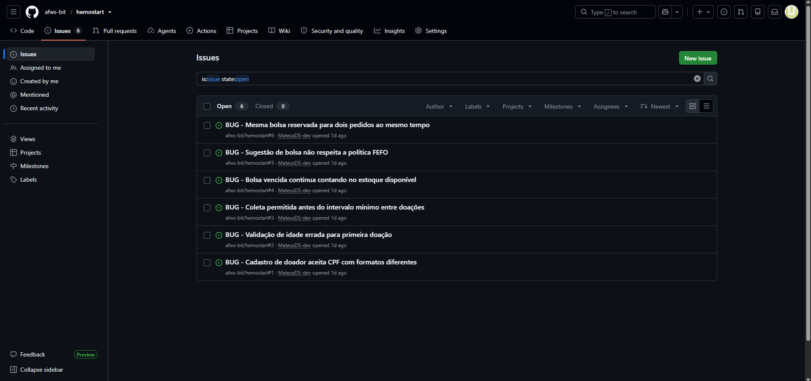

🔧 ```bash install.sh```

🌎 ```hemostart```

#  Entrega 1  Rota Vital 🩸POO

Sistema de gestão de banco de sangue desenvolvido como Projeto Integrador do 3º semestre de ADS (2026.2).

Objetivo: armazenar, controlar e distribuir bolsas de sangue de forma segura e rastreável, conectando doadores, estoque e hospitais.

## Equipe (Hemostart)

- Mateus Henrique Diniz
- Caio Catão
- João Lucas
- Kelly
- Elisa Martins
- Augusto Freitas
- Glauberson
- Daniel Luiz

## Disciplinas integradas

| Disciplina | Contribuição no projeto |
|---|---|
| Projeto | Levantamento de requisitos, histórias de usuário e BDD |
| Programação Orientada a Objetos | Modelagem e implementação das entidades do sistema |
| Algoritmos e Estruturas de Dados | Estruturas para controle de estoque e compatibilidade |
| Estatística e Probabilidade | Indicadores de estoque/demanda e análise probabilística de desabastecimento e descarte |
| Infraestrutura de Software (SO) | Ambiente de execução e implantação |
| Infraestrutura de Comunicação (RSD) | Comunicação entre sistema e hospitais |

## Documentação

- 📄 [Histórias de Usuário (BDD)](docs/historias-usuario-rota-vital.md)
 

## Figma

-https://www.figma.com/proto/CBJbIvf3z3tfEXEEG7daIm/rascunho-rota-vital?t=cgiM3bFyiB5J0S8J-1
  
## Screencast

- https://youtu.be/VbNkdUrYwnA?si=KJtaPPikWFK2a72j

## Relatório de Algoritmos e Estrutura de Dados U1

https://docs.google.com/document/d/1pvN2DdHupPwdKikVTwpOW34SZLH7y-uA_THajAqoH8A/edit?tab=t.0

## Apresentação de Estatística

https://www.youtube.com/watch?v=-s2cwjNmQJ8

# 🎓 Infraestrutura de Software - Unidade 1 (U1)

---

## 1. Atividade Prática: Mesa DJ (Concorrência e Sincronização)

**Descrição:**  
Simulador de uma mesa de DJ controlada via terminal, onde cada instrumento é executado em uma Thread independente, permitindo a reprodução simultânea de múltiplas faixas de áudio com o Pygame.

**Tecnologias:** Python 3.12 + Pygame.

🔗 **Link do Repositório:** [Clique aqui para acessar o projeto Mesa DJ](https://github.com/MateusDS-dev/mesa_dj)

## 2. Módulo de Paralelismo: Threads II (Projeto Hemostart)
Descrição:
Aceleração de uma operação CPU-bound (Validação em Lote de Compatibilidade Sanguínea ABO+Rh) utilizando processamento paralelo com ExecutorService e Virtual Threads do Java 21 (Project Loom).

Tecnologias: Java 21 + Spring Boot 3.2 + Maven + JUnit 5.

🔗 Link do Repositório: Clique aqui para acessar o projeto Threads II (Hemostart)
https://github.com/MateusDS-dev/trhds2.git


# 🎓 Infraestrutura de Software - Unidade 2 (U2)

# 🐳 E1 · Container Automatizado (Projeto RotaVital / HemoStart)

Este repositório contém a implementação do **Container Automatizado (E1)** para o Projeto Integrador. O objetivo principal é garantir que a aplicação suba do zero, em qualquer máquina, com um único comando, mantendo o ambiente de desenvolvimento idêntico ao de produção.

## ⚡ Como rodar o projeto do zero

Para subir toda a infraestrutura (API Spring Boot + Banco de Dados PostgreSQL), basta ter o Docker e o Docker Compose instalados e executar o comando abaixo na raiz do projeto:

```bash
docker compose up -d --build
```

> A API estará disponível em `http://localhost:8080`.

---

## 📂 Arquivos de Configuração

### 1. `Dockerfile` (Multi-stage Build)
O arquivo foi dividido em dois estágios para otimizar a imagem final e proteger o código-fonte.

```dockerfile
# ==========================================
# Estágio 1: Build (Ambiente de Compilação)
# ==========================================
FROM maven:3.9-eclipse-temurin-17 AS build
WORKDIR /app

# Copia apenas o pom.xml primeiro para aproveitar o cache de dependências do Docker
COPY pom.xml .
RUN mvn dependency:go-offline

# Copia o código-fonte e compila, pulando os testes (os testes rodam na esteira de CI)
COPY src ./src
RUN mvn clean package -DskipTests

# ==========================================
# Estágio 2: Run (Ambiente de Execução)
# ==========================================
FROM eclipse-temurin:17-jre-alpine
WORKDIR /app

# Copia APENAS o artefato final do estágio de build
COPY --from=build /app/target/*.jar app.jar

EXPOSE 8080
ENTRYPOINT ["java", "-jar", "app.jar"]
```

### 2. `compose.yaml` (Orquestração)
Define a rede, o banco de dados, a API e a persistência de dados.

```yaml
services:
  db:
    image: postgres:15-alpine
    container_name: rotavital_db
    environment:
      POSTGRES_USER: ${DB_USER}
      POSTGRES_PASSWORD: ${DB_PASSWORD}
      POSTGRES_DB: ${DB_NAME}
    volumes:
      - db_data:/var/lib/postgresql/data # Volume nomeado para persistência
    healthcheck:
      test: ["CMD-SHELL", "pg_isready -U ${DB_USER} -d ${DB_NAME}"]
      interval: 5s
      timeout: 5s
      retries: 5
    networks:
      - rotavital_network

  api:
    build: . 
    container_name: rotavital_api
    ports:
      - "8080:8080"
    environment:
      - SPRING_DATASOURCE_URL=jdbc:postgresql://db:5432/${DB_NAME}
      - SPRING_DATASOURCE_USERNAME=${DB_USER}
      - SPRING_DATASOURCE_PASSWORD=${DB_PASSWORD}
    depends_on:
      db:
        condition: service_healthy # Só inicia a API após o banco estar pronto
    networks:
      - rotavital_network

volumes:
  db_data:

networks:
  rotavital_network:
    driver: bridge
```

### 3. `.env.example` (Configuração Fora do Código)

```env
DB_USER=admin_rotavital
DB_PASSWORD=senha_segura_123
DB_NAME=rotavital_db
```

---

## 🧠 Justificativas Técnicas (Critérios de Avaliação)

Para atender aos requisitos da disciplina, abaixo estão as justificativas das decisões de infraestrutura tomadas:

> **1. Por que usamos Multi-stage Build?**
> Para separar o ambiente de *build* (que exige Maven, JDK completo e baixa muitos pacotes) do ambiente de *execução* (que só precisa do JRE). O resultado é uma imagem final extremamente enxuta, mais rápida de ser baixada em produção e mais segura (pois não contém o código-fonte original ou ferramentas de compilação).
> 
> **2. Escolha da Imagem Base (Tamanho e Segurança)**
> No estágio de execução, utilizamos `eclipse-temurin:17-jre-alpine`. A distribuição **Alpine Linux** foi escolhida por ser notoriamente leve. Isso reduz o tamanho total da imagem da nossa API drasticamente (de ~800MB para menos de 200MB). Além disso, por ter menos bibliotecas do sistema operacional instaladas, a superfície de ataque contra vulnerabilidades é reduzida.
> 
> **3. Onde ficam os dados? (Volume)**
> O PostgreSQL salva os dados nativamente em `/var/lib/postgresql/data`. No Compose, mapeamos esse diretório para um **Volume Nomeado** (`db_data`). Isso garante a persistência: se rodarmos `docker compose down` e subirmos novamente, os dados dos doadores e do estoque de sangue não serão perdidos.
> 
> **4. Como os serviços se encontram? (Rede do Compose)**
> Criamos uma rede customizada *bridge* (`rotavital_network`). O Docker cria um DNS interno para essa rede. Por isso, a API encontra o banco de dados usando a URL `jdbc:postgresql://db:5432/...` (onde `db` é o nome do serviço definido no compose). Para garantir a ordem de inicialização, usamos o `depends_on` aliado a um `healthcheck` no banco, impedindo que a API suba antes do banco estar pronto para receber conexões.

---

## 📸 Evidências de Execução


- [x] **Print 1:** Terminal executando o comando `docker compose up -d --build` com sucesso.
- [x] **Print 2:** Terminal executando `docker ps` mostrando os containers `rotavital_api` e `rotavital_db` (com status *healthy*).
- [x] **Print 3:** Navegador acessando `http://localhost:8080` exibindo a tela do sistema (Painel Geral), provando que a API e o Banco estão se comunicando.

---


#  Entrega 2  Rota Vital 🩸POO

## historias atualizadas h09 h10

- 📄 [Histórias de Usuário (BDD)](docs/historias-usuario-rota-vital.md)
 
##-Issue/bug tracker


## Screencast
-https://youtu.be/wTMYO7UHukY
-https://youtu.be/0rAuU5NEjrw

## Status

🚧 Em desenvolvimento
