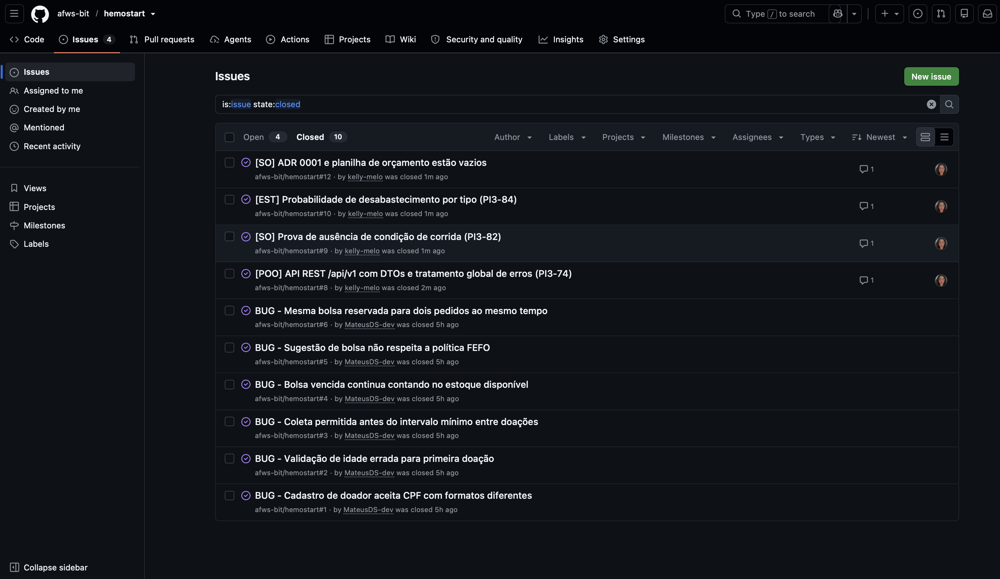
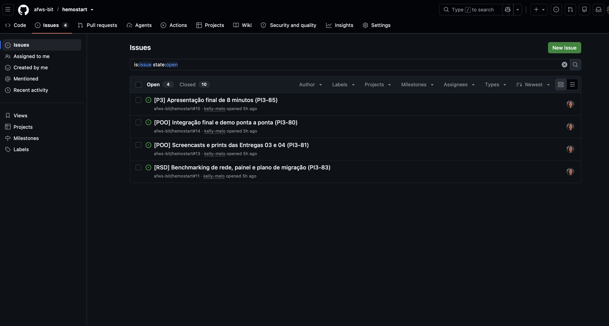
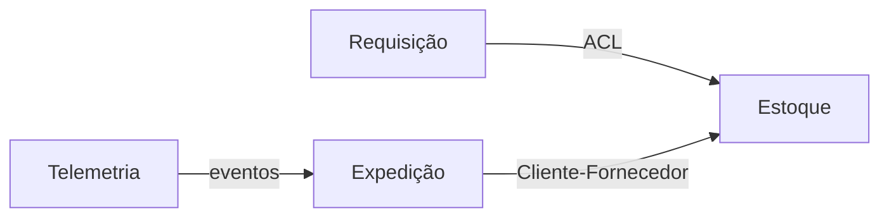
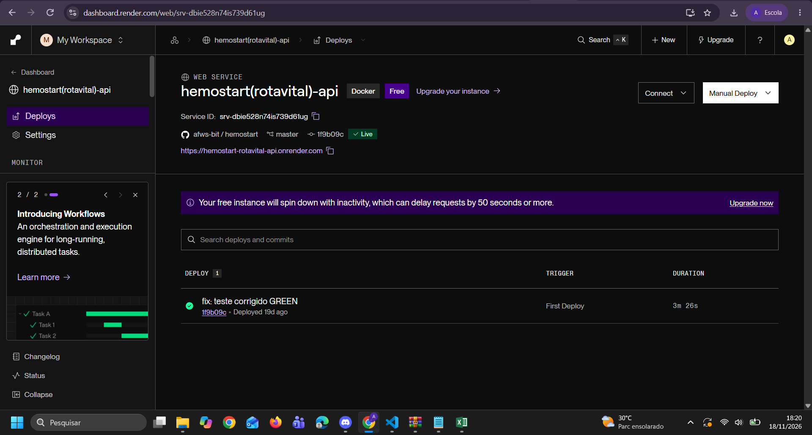
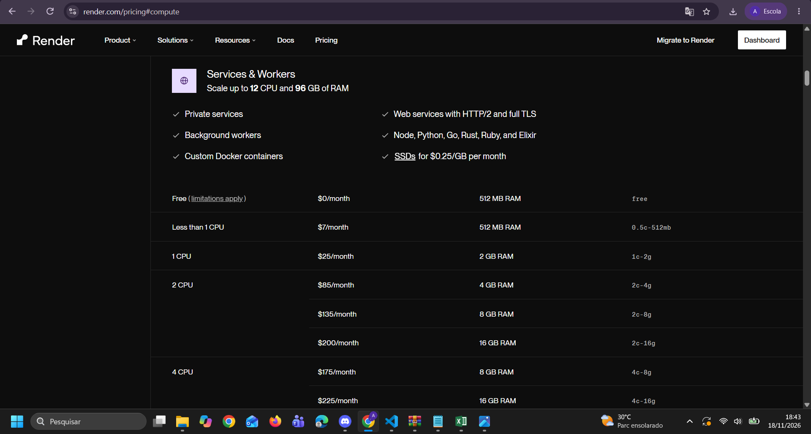
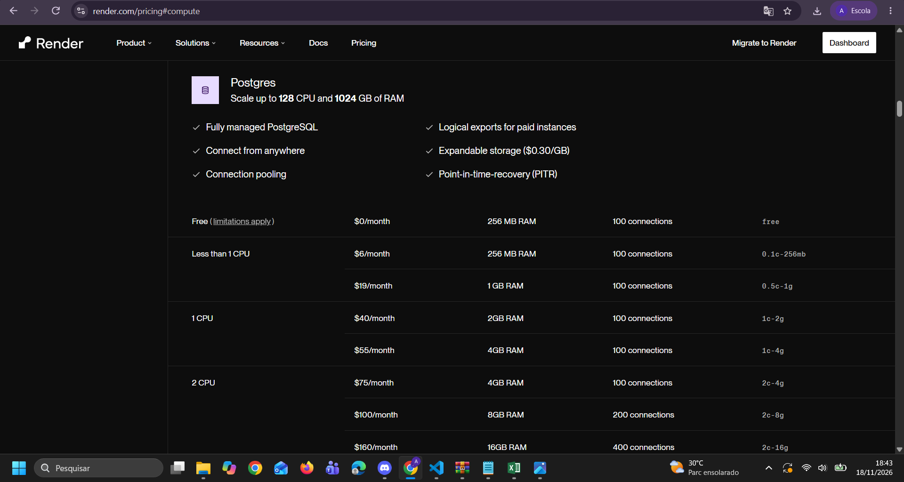
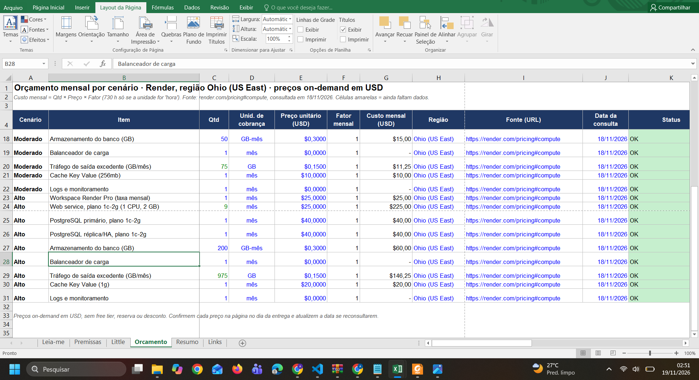

# 🩸 Rota Vital — Sistema de Gestão de Banco de Sangue

> Projeto da disciplina **Programação Orientada a Objetos (POO) — CESAR School 2026.2** · Equipe **Hemostart**
>
> 🌎 Deploy: https://hemostart-rotavital-api.onrender.com/

## 📌 Descrição do projeto

O **Rota Vital** é uma aplicação web que armazena, controla e distribui bolsas de sangue de forma segura e rastreável, conectando **doadores**, **estoque** e **hospitais**.

O problema: bancos de sangue ainda controlam estoque e pedidos em planilhas, o que gera bolsas vencendo na prateleira, falta de tipos raros sem aviso prévio e pouca rastreabilidade de quem recebeu cada bolsa. O Rota Vital resolve isso com:

- cadastro de doadores com regras de elegibilidade (idade, peso, intervalo entre doações);
- registro de coletas com código único e validade calculada automaticamente;
- painel de estoque por tipo sanguíneo com **alerta de estoque crítico**;
- validação automática de **compatibilidade ABO/Rh** e sugestão de bolsas por **FEFO** (vence primeiro, sai primeiro);
- fila de solicitações de hospitais com **prioridade para urgências**;
- distribuição com rastreio completo (coleta → reserva → distribuição/descarte) e relatórios por período.

## 🛠️ Tecnologias usadas

| Camada | Tecnologia |
|---|---|
| Linguagem | Java 17 |
| Framework | Spring Boot 3.2 (Spring MVC, Spring Data JPA, Scheduling) |
| Interface web | Thymeleaf + HTML + CSS |
| Banco de dados | **PostgreSQL 15** (Docker / Render) · **H2** (execução local e testes) |
| ORM | Hibernate / JPA |
| Build | Maven |
| Testes | JUnit 5 + Spring Boot Test (testes de unidade e de integração com banco) |
| Infra | Docker (multi-stage), Docker Compose, GitHub Actions (CI), Render (deploy) |
| Gestão | GitHub Issues (bug tracker), Figma (protótipo Lo-Fi) |

> ⚠️ Conforme exigido na disciplina, **não usamos Lombok** nem qualquer gerador de boilerplate: getters, setters, construtores, `equals`/`hashCode` foram escritos à mão.

## ▶️ Como rodar o projeto

### Opção 1 — Local, sem Docker (banco H2 em arquivo)

Pré-requisitos: **JDK 17+** e **Maven 3.9+**.

```bash
git clone https://github.com/afws-bit/hemostart.git
cd hemostart
mvn spring-boot:run
```

- Aplicação: http://localhost:8080
- Os dados ficam gravados em `./data/rotavital.mv.db` (sobrevivem ao reiniciar).
- Console do banco: http://localhost:8080/h2-console → JDBC URL `jdbc:h2:file:./data/rotavital`, usuário `sa`, senha vazia.
- Na primeira execução o sistema cria doadores, hospitais e bolsas de exemplo (desligue com `--rotavital.dados-iniciais=false`).

### Opção 2 — Docker Compose (API + PostgreSQL)

```bash
cp .env.example .env
docker compose up -d --build
```

A API sobe em http://localhost:8080 já conectada ao PostgreSQL (variáveis `SPRING_DATASOURCE_*` do `compose.yaml`).

### Rodar os testes

```bash
mvn test
```

Os testes de integração usam H2 em memória e sempre leem e gravam no banco:

| Classe de teste | O que cobre |
|---|---|
| `HistoriasIntegracaoTest` | HU01–HU10 + rota da AED |
| `HistoriasNovasTests` | HU11–HU14, incluindo as telas via MockMvc |
| `ApiRestTest` | API REST `/api/v1`: DTOs e erros 400/403/404/409 |
| `ConcorrenciaEstoqueTest` | ausência de condição de corrida (SO) |
| `EstatisticaDesabastecimentoTest` | probabilidade de desabastecimento (EST) |
| `AedAlgoritmosTest` | algoritmos da AED |
| `MonitoramentoRedeTest`, `monitoramento.MonitorRedeTest`, `PainelRedeTest` | painel de monitoramento de rede (RSD) |
| `ObservabilidadeTest` | Actuator/Prometheus com tag `application`, métricas de negócio, spans de serviço e repositório |

## 🧱 Arquitetura e Orientação a Objetos

```
br.com.rotavital
├── model        Entidades JPA (Doador, Hospital, BolsaSangue, Requisicao, Agendamento, TriagemClinica,
│                HistoricoOperacao, Configuracao)
│                + enums de domínio (TipoSanguineo, Componente, StatusBolsa, StatusRequisicao, TipoOperacao)
├── repository   Interfaces Spring Data JPA (uma por entidade)
├── service      Regras de negócio / casos de uso (@Transactional)
├── controller   Controllers MVC (Thymeleaf) e endpoints de estatística
│   └── api      API REST /api/v1 (contrato do MVP) + tratamento global de erros
├── estruturas   Lista encadeada, fila com prioridade e pilha (AED U1)
├── aed          Matriz ABO/Rh, FEFO, hash, rota por vizinho mais próximo e alocador (AED U2)
├── scheduler    Verificação periódica de validade
├── config       Carga de dados iniciais e mapa de rotas
├── concorrencia SecaoCritica (exclusão mútua com commit dentro da trava)
├── monitoramento Painel de rede (RSD): filtro HTTP, sonda do banco, métricas de latência/jitter/perda/vazão
├── observabilidade Spans por camada (Tempo), métricas de negócio Micrometer (Prometheus)
├── dto          DTOs de estatística; dto/api: entrada e saída da API REST (records)
└── exception    RegraNegocioException, RecursoNaoEncontradoException (404), AcessoNegadoException (403)
```

**Entidades persistidas (8):** `Doador`, `Hospital`, `BolsaSangue`, `Requisicao`, `Agendamento`, `TriagemClinica`, `HistoricoOperacao`, `Configuracao`.
Relacionamentos: `BolsaSangue → Doador` (N:1), `BolsaSangue → Hospital` destino (N:1), `BolsaSangue → Requisicao` (N:1), `Requisicao → Hospital` (N:1), `Agendamento → Doador` (N:1), `TriagemClinica → Doador` (N:1).

Princípios de POO aplicados:

- **Encapsulamento / modelo rico:** as transições de estado ficam na própria entidade (`bolsa.reservarPara()`, `bolsa.distribuir()`, `bolsa.descartar()`, `bolsa.atualizarValidade()`), que protege as invariantes — por exemplo, lança `RegraNegocioException("Bolsa já distribuída anteriormente")`.
- **Herança:** `Doador`, `Hospital`, `Requisicao`, `Agendamento`, `TriagemClinica` e `HistoricoOperacao` herdam de `EntidadeBase` (`@MappedSuperclass`), que gera o UUID e implementa `equals`/`hashCode`.
- **Polimorfismo / enums com comportamento:** `TipoSanguineo.podeDoarPara(receptor)` implementa a regra ABO/Rh; `Componente` sabe sua validade (42, 5 ou 365 dias).
- **Responsabilidade única e injeção de dependências por construtor:** controllers só tratam HTTP, services contêm regras, repositories acessam o banco.
- **Tratamento de erros com exceções** de domínio em vez de códigos de retorno, e um `@RestControllerAdvice` que converte cada exceção num JSON padronizado com o status HTTP correto.
- **DTOs (records imutáveis)** na API: a API REST nunca expõe as entidades JPA. O CPF sai mascarado e o histórico de saúde não sai.

## 🔌 API REST (`/api/v1`)

Implementa o contrato de API definido pela equipe no documento de Projetos 3 / RSD (15 endpoints do MVP), mais aprovação e recusa de solicitações (HU13). Todas as respostas são JSON; os erros seguem um formato único:

```json
{ "timestamp": "2026-11-18T17:00:00", "status": 409, "erro": "Conflict",
  "mensagem": "CPF já cadastrado", "caminho": "/api/v1/doadores", "detalhes": [] }
```

| Método | Endpoint | Status |
|---|---|---|
| POST | `/api/v1/doadores` | 201, 400, 409 |
| GET | `/api/v1/doadores/{id}` | 200, 404 |
| POST | `/api/v1/coletas` | 201, 400, 404, 409 |
| GET | `/api/v1/estoque` | 200 |
| GET | `/api/v1/bolsas/{id}` | 200, 404 |
| GET | `/api/v1/bolsas/{id}/historico` | 200, 404 |
| GET | `/api/v1/bolsas/alertas-validade` | 200 |
| POST | `/api/v1/bolsas/{id}/descarte` | 200, 400, 404, 409 |
| GET | `/api/v1/compatibilidade?tipo=O-&quantidade=2` | 200, 400 |
| POST | `/api/v1/solicitacoes` | 201, 400, 403 |
| GET | `/api/v1/solicitacoes` | 200 |
| GET | `/api/v1/solicitacoes/{id}` | 200, 404 |
| POST | `/api/v1/solicitacoes/{id}/aprovacao` | 200, 404, 409 |
| POST | `/api/v1/solicitacoes/{id}/recusa` | 200, 400, 404, 409 |
| POST | `/api/v1/distribuicoes` | 201, 400, 404, 409 |
| GET | `/api/v1/relatorios/doacoes?inicio=&fim=&tipoSanguineo=&hospitalId=` | 200, 400 |
| GET | `/api/v1/relatorios/distribuicoes?inicio=&fim=&tipoSanguineo=&hospitalId=` | 200, 400 |

## 👥 Equipe
| Nome completo | E-mail CESAR School |
|---|---|
| Augusto Freitas Wanderley de Siqueira | afws@cesar.school |
| Caio Catão Zenaide Costa | cczc@cesar.school |
| Daniel Luiz Massud de Sousa Filho | ddlmsf@cesar.school |
| Elisa Martins Galindo Santos | emgs2@cesar.school |
| Glauberson Ribeiro de Siqueira | grs4@cesar.school |
| João Lucas Mendes dos Santos | jlms@cesar.school |
| Kelly Priscilla de Siqueira Melo | kpsm@cesar.school |
| Mateus Henrique Diniz Silva | mhds@cesar.school |

### Membros anteriores / novos

| Nome completo | E-mail CESAR School | Entrada | Saída |
|---|---|---|---|
| Igor Kaua de Souza Siqueira | ikss2@cesar.school | 05/10/2026 | — |

---

# 📦 Entregas — POO

## Entrega 01 (31/08)

- 📄 [Histórias de usuário com cenários BDD (HU01–HU10)](docs/historias-usuario-rota-vital.md)
- 🎨 [Protótipo Lo-Fi no Figma](https://www.figma.com/proto/CBJbIvf3z3tfEXEEG7daIm/rascunho-rota-vital?t=cgiM3bFyiB5J0S8J-1)
- 🎥 [Screencast do protótipo](https://youtu.be/VbNkdUrYwnA?si=KJtaPPikWFK2a72j)

## Entrega 02 (21/09)

### Histórias implementadas

> **HU01 — Cadastro de Doador**
> Como **atendente**, quero **cadastrar doadores com CPF, nascimento, tipo sanguíneo e peso**, para **ter um registro confiável de quem pode doar**.
> ✔ CPF único · ✔ idade 16–69 anos · ✔ peso mínimo 50 kg

> **HU02 — Registro de Coleta**
> Como **enfermeiro**, quero **registrar a bolsa coletada vinculada ao doador**, para **que ela entre no estoque e seja rastreável**.
> ✔ código único BS-xxxxx · ✔ validade automática por componente · ✔ intervalo mínimo 60/90 dias

- 📄 [Histórias atualizadas (HU09 e HU10 adicionadas)](docs/historias-usuario-rota-vital.md)
- 🐞 Issue tracker:

  

- 🎥 Screencast do sistema rodando: https://youtu.be/wTMYO7UHukY
- 🎥 Screencast do código: https://youtu.be/0rAuU5NEjrw

## Entrega 03 (19/10)

### Histórias implementadas

> **HU03 — Controle de Estoque por Tipo Sanguíneo**
> Como **gestor**, quero **ver as bolsas por tipo e status**, para **decidir rapidamente sobre reposição e distribuição**.
> ✔ painel com os 8 tipos · ✔ vencidas mudam de status automaticamente

> **HU04 — Validação de Compatibilidade Sanguínea**
> Como **sistema**, quero **validar a compatibilidade ABO/Rh entre bolsa e paciente**, para **liberar apenas bolsas seguras**.
> ✔ tabela oficial de compatibilidade · ✔ sugestão FEFO · ✔ bloqueio de tipo incompatível

> **HU05 — Solicitação de Sangue por Hospital**
> Como **hospital cadastrado**, quero **solicitar bolsas informando tipo, quantidade e urgência**, para **ser atendido conforme a necessidade clínica**.
> ✔ só hospitais ativos · ✔ urgentes no topo da fila

> **HU11 — Agendamento de Doação**
> Como **doador**, quero **agendar dia e horário para doar**, para **evitar filas e garantir atendimento**.
> ✔ limite de vagas por horário · ✔ respeita o intervalo mínimo · ✔ cancelamento libera a vaga

> **HU12 — Triagem Clínica Pré-Doação**
> Como **profissional de triagem**, quero **registrar peso, pressão, temperatura e hemoglobina**, para **liberar só doadores aptos**.
> ✔ hemoglobina mínima por sexo · ✔ coleta bloqueada para inaptos

- 📄 [Histórias atualizadas (HU11 e HU12 adicionadas)](docs/historias-usuario-rota-vital.md)

- 🐞 Issue tracker:

  
- 🎥 Screencast do sistema (novas histórias): https://youtu.be/n7OuBEKGsH8
- 🎥 Screencast do código: https://youtu.be/pqmrW3mxU8o

## Entrega 04 (09/11)

### Histórias implementadas


> **HU06 — Distribuição e Rastreio de Bolsas**
> Como **operador logístico**, quero **registrar a saída da bolsa vinculada ao pedido**, para **rastrear cada bolsa da coleta até a entrega**.
> ✔ data, hora, responsável e hospital destino · ✔ bloqueio de distribuição duplicada

> **HU07 — Controle de Validade e Descarte**
> Como **gestor de qualidade**, quero **ser alertado sobre bolsas perto de vencer e descartar as vencidas**, para **evitar desperdício e uso indevido**.
> ✔ alerta “uso prioritário” (≤ 5 dias) · ✔ descarte com responsável

> **HU08 — Histórico e Relatório**
> Como **gestor**, quero **relatórios de coletas, distribuições e descartes por período**, para **acompanhar indicadores operacionais**.
> ✔ filtro por período, tipo sanguíneo e hospital

> **HU09 — Cadastro de Hospital**
> Como **administrador**, quero **cadastrar e ativar/inativar hospitais**, para **que apenas instituições autorizadas solicitem sangue**.
> ✔ CNPJ único · ✔ inativos não solicitam

> **HU10 — Alerta de Estoque Crítico**
> Como **gestor**, quero **definir um nível mínimo por tipo e ser alertado abaixo dele**, para **organizar campanhas de doação a tempo**.
> ✔ mínimo configurável e salvo no banco · ✔ alerta some quando o estoque normaliza

> **HU13 — Aprovação e Recusa de Solicitações**
> Como **gestor**, quero **aprovar ou recusar cada solicitação**, para **controlar a saída de bolsas**.
> ✔ aprovação reserva bolsas compatíveis (FEFO + rota) · ✔ recusa exige motivo e fica no histórico

> **HU14 — Histórico e Próxima Data Apta do Doador**
> Como **atendente**, quero **ver as doações de um doador e quando ele pode doar de novo**, para **orientar o agendamento**.
> ✔ lista de doações · ✔ próxima data apta (60/90 dias)

**Persistência:** todas as histórias leem e gravam no banco de dados relacional (PostgreSQL em produção / H2 local) via Spring Data JPA.

- 📄 [Histórias atualizadas (HU13 e HU14 adicionadas)](docs/historias-usuario-rota-vital.md)

- 🐞 Issue tracker:

  
- 🎥 Screencast do sistema (ênfase nas novas histórias): https://youtu.be/aRv-U-uCGIc
- 🎥 Screencast do código: https://youtu.be/E-zOMA_yxRE

## Apresentação final (09/11 a 13/11)

- 🎤 Slides da apresentação: [Rota_Vital.pdf](docs/Rota_Vital.pdf)

---

# 📚 Outras disciplinas do Projeto Integrador

| Disciplina | Contribuição no projeto |
|---|---|
| Projeto | Levantamento de requisitos, histórias de usuário e BDD |
| Programação Orientada a Objetos | Modelagem e implementação das entidades do sistema |
| Algoritmos e Estruturas de Dados | Estruturas para controle de estoque e compatibilidade |
| Estatística e Probabilidade | Indicadores de estoque/demanda e análise probabilística de desabastecimento e descarte |
| Infraestrutura de Software (SO) | Ambiente de execução e implantação |
| Infraestrutura de Comunicação (RSD) | Comunicação entre sistema e hospitais |

### 🧮 AED — Unidades 1 e 2 (C++ + Java + tradução comentada)

- 📄 **[Tradução comentada C++ ↔ Java e análise de complexidade](docs/aed/traducao-comentada.md)**: lista, fila e pilha (U1); matriz ABO/Rh, FEFO, hash e vizinho mais próximo (U2).
- **C++** (raiz do repo): `ListaEstoque`, `FilaRequisicoes`, `PilhaHistorico`, `Compatibilidade`, `FilaFEFO`, `TabelaHash`, `Grafo` e `Alocador` (integração).
  ```bash
  g++ -std=c++17 -Wall main.cpp -o hemostart && ./hemostart   # demonstração + 24 verificações automáticas
  ```
- **Java** (`src/main/java/br/com/rotavital/aed` e `estruturas`): mesma lógica, integrada à aplicação. Em **Requisições → Reservar**, o pedido recebe a bolsa compatível que vence primeiro e a rota calculada. Testes em `AedAlgoritmosTest`.

### 🌐 RSD — Infraestrutura de Comunicação

- 🗺️ Diagrama de arquitetura (VPC, sub-redes, portas e protocolos), revisado em 18/11 com a camada de dados em PostgreSQL: [PDF](docs/arquitetura/rsd/arquitetura-hemostart-martins-melo.pdf) · [fonte draw.io](docs/arquitetura/rsd/arquitetura-hemostart-martins-melo.drawio)
- Contrato da API REST implementado: seção [🔌 API REST](#-api-rest-apiv1).

**Unidade 2 — Notificações de estoque crítico em tempo real (WebSocket)**

- Endpoint `wss://<host>/ws/estoque` (no Render: `wss://hemostart-rotavital-api.onrender.com/ws/estoque`), na mesma porta HTTPS da aplicação: o navegador faz o *handshake* HTTP (`Upgrade: websocket` → `101 Switching Protocols`) e o servidor passa a **empurrar** as mensagens, sem o cliente perguntar.
- Ao conectar, o cliente recebe a situação dos 8 tipos (disponível × mínimo configurado). Depois de cada coleta, reserva, distribuição, descarte, vencimento ou mudança de mínimo, o servidor recalcula e avisa todos os clientes; quando um tipo **entra em crítico** ou **volta ao normal**, a tela mostra um aviso.
- Telas **Início** e **Estoque** com indicador "● ao vivo", lista de alertas e cards por tipo atualizados sem recarregar; reconexão automática (1 s → 30 s).
- Código: [`notificacao/`](src/main/java/br/com/rotavital/notificacao) · front-end [`estoque-ao-vivo.js`](src/main/resources/static/js/estoque-ao-vivo.js) · teste ponta a ponta [`NotificacaoEstoqueWebSocketTest`](src/test/java/br/com/rotavital/notificacao/NotificacaoEstoqueWebSocketTest.java) (servidor em porta real + cliente WebSocket).

**Unidade 2 — Projeto de observabilidade (Actuator, Prometheus, Grafana, Loki e Tempo)** → [`observabilidade/`](observabilidade/README.md)

- Um comando sobe tudo: `cd observabilidade && cp .env.example .env && docker compose up -d --build`
- Aplicação instrumentada com Actuator (`/actuator/prometheus` na porta interna 8081, tag `application=hemostart`), traces no Tempo com spans controller → serviço → banco, logs no Loki com `traceId`
- Prometheus com 8 alvos (app, Node Exporter, cAdvisor, postgres_exporter, Loki, Tempo, Alloy, Prometheus), 2 dashboards versionados, 8 métricas de negócio
- Acesso remoto do professor: túnel Cloudflare só para o Grafana, com usuário Viewer criado automaticamente

**Unidade 2 — implantação, benchmarking e painel de rede**

| Critério (peso) | Entregável |
|---|---|
| Benchmarking: latência, vazão, perda e jitter (40%) | [Relatório de benchmarking](docs/rsd/benchmarking.md) · script [`benchmark_rede.py`](docs/rsd/benchmark/benchmark_rede.py) (DNS, ping, TCP, TLS, HTTPS por endpoint e carga com 1/5/10 clientes) |
| Painel de monitoramento (35%) | Tela **Rede** (`/rede`) no sistema · JSON em `GET /api/monitoramento/rede` · [documentação do painel](docs/rsd/painel-monitoramento.md) |
| Plano de implantação/migração (25%) | [Plano de implantação e migração](docs/rsd/plano-implantacao-migracao.md): JSON → PostgreSQL (realizada) e Render → VPC (planejada), metas, rollback e riscos |

Para medir: `cd docs/rsd/benchmark` e `python benchmark_rede.py --origem "sua rede, cidade"`.

### 📈 EST — Probabilidade de Desabastecimento e Métricas Revisadas (U2)

Para a Unidade 2, a disciplina de Estatística exigiu a modelagem preditiva de desabastecimento e a revisão das métricas de desperdício. Todo o embasamento teórico, premissas e resultados estão documentados no relatório técnico.

- 📄 **[Relatório de Achados (Poisson, Premissas, Resultados e Recomendações)](docs/est/relatorio-desabastecimento.md)**

#### 1. Modelo Preditivo de Desabastecimento (Poisson)
- **O Método:** Utilizamos a distribuição de Poisson para modelar a demanda futura de bolsas por tipo sanguíneo, assumindo que os pedidos chegam de forma independente e com taxa média constante (janela móvel de 30 dias).
- **A Conta:** A demanda em um horizonte \(H\) é dada por \(D \sim Poisson(\lambda \cdot H)\). O estoque útil (\(k\)) é calculado subtraindo o nível mínimo (HU10) do estoque disponível menos as bolsas que vencerão no período.
- **O Risco:** O risco de desabastecimento é \(P(D > k)\). O sistema classifica esse risco em **BAIXO, MODERADO ou ALTO**.
- **No Sistema:** O painel de relatórios exibe o card "Risco de Desabastecimento", consumindo o endpoint `GET /api/estatisticas/desabastecimento?horizonteDias=7&janelaDias=30`.

#### 2. Revisão da Métrica de Desperdício
- **O Problema Anterior:** Na Parte 1, a métrica contava cada bolsa descartada como `1.0`, o que resultava em média 1 e desvio padrão 0 (sem variação estatística real).
- **A Solução (PI3-84):** A métrica foi revisada para agrupar os descartes **por semana** (nas últimas 8 semanas). Agora o sistema calcula a **média, mediana e o desvio padrão amostral** (dividindo por \(n-1\)), permitindo identificar se o desperdício está concentrado ou pulverizado.
- **No Sistema:** Implementado no `EstatisticaService.java` e validado pela classe de testes `EstatisticaDesabastecimentoTest.java`.

#### 3. Dados e Premissas (Transparência)
- **Dados:** O sistema utiliza exclusivamente os dados sintéticos gerados pelo próprio Rota Vital (coletas, distribuições e vencimentos).
- **Premissas:** Eventos independentes, taxa média constante no período e análise isolada por tipo sanguíneo (não considerando, nesta versão, a substituição de tipos universais como O-).

### Relatório de Algoritmos e Estrutura de Dados U1

https://docs.google.com/document/d/1pvN2DdHupPwdKikVTwpOW34SZLH7y-uA_THajAqoH8A/edit?tab=t.0

### Apresentação de Estatística

https://www.youtube.com/watch?v=-s2cwjNmQJ8

## 🎓 Infraestrutura de Software - Unidade 1 (U1)

---

### 1. Atividade Prática: Mesa DJ (Concorrência e Sincronização)

**Descrição:**  
Simulador de uma mesa de DJ controlada via terminal, onde cada instrumento é executado em uma Thread independente, permitindo a reprodução simultânea de múltiplas faixas de áudio com o Pygame.

**Tecnologias:** Python 3.12 + Pygame.

🔗 **Link do Repositório:** [Clique aqui para acessar o projeto Mesa DJ](https://github.com/MateusDS-dev/mesa_dj)

### 2. Módulo de Paralelismo: Threads II (Projeto Hemostart)

**Descrição:**  
Aceleração de uma operação CPU-bound (Validação em Lote de Compatibilidade Sanguínea ABO+Rh) utilizando processamento paralelo com ExecutorService e Virtual Threads do Java 21 (Project Loom).

**Tecnologias:** Java 21 + Spring Boot 3.2 + Maven + JUnit 5.

🔗 **Link do Repositório:** [Clique aqui para acessar o projeto Threads II (Hemostart)](https://github.com/MateusDS-dev/trhds2.git)


## 🎓 Infraestrutura de Software - Unidade 2 (U2)

### 🔒 Teste de ausência de condição de corrida

As operações que disputam o mesmo estoque passam pela classe `SecaoCritica` (pacote `concorrencia`): registrar coleta, aprovar ou recusar solicitação, distribuir, descartar, verificar validade e agendar. A ordem é **trava → abre transação → executa → commit → solta a trava**. Com `synchronized` + `@Transactional`, o commit acontecia *depois* de soltar a trava, e outra thread podia ler o banco desatualizado.

O `ConcorrenciaEstoqueTest` dispara várias threads ao mesmo tempo, todas liberadas juntas por um `CountDownLatch`, e prova que:
- **16 coletas simultâneas** geram 16 códigos de bolsa diferentes;
- **8 aprovações simultâneas** disputando **1 bolsa**: só uma é aprovada, e a bolsa nunca é reservada duas vezes (issue #6);
- **8 agendamentos simultâneos** no mesmo horário respeitam o limite de 2 vagas.

**URL Pública (Deploy):** https://hemostart-rotavital-api.onrender.com/

## 🐳 E1 · Container Automatizado (Projeto RotaVital / HemoStart)

Este repositório contém a implementação do **Container Automatizado (E1)** para o Projeto Integrador. O objetivo principal é garantir que a aplicação suba do zero, em qualquer máquina, com um único comando, mantendo o ambiente de desenvolvimento idêntico ao de produção.

### ⚡ Como rodar o projeto do zero

Para subir toda a infraestrutura (API Spring Boot + Banco de Dados PostgreSQL), basta ter o Docker e o Docker Compose instalados e executar o comando abaixo na raiz do projeto:

```bash
docker compose up -d --build
```

> A API estará disponível em `http://localhost:8080`.

---

### 📂 Arquivos de Configuração

#### 1. `Dockerfile` (Multi-stage Build)
O arquivo foi dividido em dois estágios para otimizar a imagem final e proteger o código-fonte.

```dockerfile
# ==========================================
# Estágio 1: Build (Ambiente de Compilação)
# ==========================================
FROM maven:3.9-eclipse-temurin-17 AS build
WORKDIR /app

# Copia apenas o pom.xml primeiro para aproveitar o cache de dependências do Docker
COPY pom.xml .
RUN mvn dependency:go-offline

# Copia o código-fonte e compila, pulando os testes (os testes rodam na esteira de CI)
COPY src ./src
RUN mvn clean package -DskipTests

# ==========================================
# Estágio 2: Run (Ambiente de Execução)
# ==========================================
FROM eclipse-temurin:17-jre-alpine
WORKDIR /app

# Copia APENAS o artefato final do estágio de build
COPY --from=build /app/target/*.jar app.jar

EXPOSE 8080
ENTRYPOINT ["java", "-jar", "app.jar"]
```

#### 2. `compose.yaml` (Orquestração)
Define a rede, o banco de dados, a API e a persistência de dados.

```yaml
services:
  db:
    image: postgres:15-alpine
    container_name: rotavital_db
    environment:
      POSTGRES_USER: ${DB_USER}
      POSTGRES_PASSWORD: ${DB_PASSWORD}
      POSTGRES_DB: ${DB_NAME}
    volumes:
      - db_data:/var/lib/postgresql/data # Volume nomeado para persistência
    healthcheck:
      test: ["CMD-SHELL", "pg_isready -U ${DB_USER} -d ${DB_NAME}"]
      interval: 5s
      timeout: 5s
      retries: 5
    networks:
      - rotavital_network

  api:
    build: . 
    container_name: rotavital_api
    ports:
      - "8080:8080"
    environment:
      - SPRING_DATASOURCE_URL=jdbc:postgresql://db:5432/${DB_NAME}
      - SPRING_DATASOURCE_USERNAME=${DB_USER}
      - SPRING_DATASOURCE_PASSWORD=${DB_PASSWORD}
    depends_on:
      db:
        condition: service_healthy # Só inicia a API após o banco estar pronto
    networks:
      - rotavital_network

volumes:
  db_data:

networks:
  rotavital_network:
    driver: bridge
```

#### 3. `.env.example` (Configuração Fora do Código)

```env
DB_USER=admin_rotavital
DB_PASSWORD=senha_segura_123
DB_NAME=rotavital_db
```

---

### 🧠 Justificativas Técnicas (Critérios de Avaliação)

Para atender aos requisitos da disciplina, abaixo estão as justificativas das decisões de infraestrutura tomadas:

> **1. Por que usamos Multi-stage Build?**
> Para separar o ambiente de *build* (que exige Maven, JDK completo e baixa muitos pacotes) do ambiente de *execução* (que só precisa do JRE). O resultado é uma imagem final extremamente enxuta, mais rápida de ser baixada em produção e mais segura (pois não contém o código-fonte original ou ferramentas de compilação).
> 
> **2. Escolha da Imagem Base (Tamanho e Segurança)**
> No estágio de execução, utilizamos `eclipse-temurin:17-jre-alpine`. A distribuição **Alpine Linux** foi escolhida por ser notoriamente leve. Isso reduz o tamanho total da imagem da nossa API drasticamente (de ~800MB para menos de 200MB). Além disso, por ter menos bibliotecas do sistema operacional instaladas, a superfície de ataque contra vulnerabilidades é reduzida.
> 
> **3. Onde ficam os dados? (Volume)**
> O PostgreSQL salva os dados nativamente em `/var/lib/postgresql/data`. No Compose, mapeamos esse diretório para um **Volume Nomeado** (`db_data`). Isso garante a persistência: se rodarmos `docker compose down` e subirmos novamente, os dados dos doadores e do estoque de sangue não serão perdidos.
> 
> **4. Como os serviços se encontram? (Rede do Compose)**
> Criamos uma rede customizada *bridge* (`rotavital_network`). O Docker cria um DNS interno para essa rede. Por isso, a API encontra o banco de dados usando a URL `jdbc:postgresql://db:5432/...` (onde `db` é o nome do serviço definido no compose). Para garantir a ordem de inicialização, usamos o `depends_on` aliado a um `healthcheck` no banco, impedindo que a API suba antes do banco estar pronto para receber conexões.

---

### 📸 Evidências de Execução


- [x] **Print 1:** Terminal executando o comando `docker compose up -d --build` com sucesso.
- [x] **Print 2:** Terminal executando `docker ps` mostrando os containers `rotavital_api` e `rotavital_db` (com status *healthy*).
- [x] **Print 3:** Navegador acessando `http://localhost:8080` exibindo a tela do sistema (Painel Geral), provando que a API e o Banco estão se comunicando.

### 🧪 E2 · TDD (Test-Driven Development)

#### Story Map (Release 1)
1. **História: Validação de Compatibilidade Sanguínea**
   - Tarefas: Criar Enum de tipos; Implementar lógica de compatibilidade (Regra de negócio crítica); Escrever teste unitário.
2. **História: Cadastro de Doador**
   - Tarefas: Criar entidade e repositório; Criar endpoint e validações; Testes de integração com banco de dados.
3. **História: Alerta de Estoque Crítico e FEFO**
   - Tarefas: Query de contagem; Regra de negócio para disparar alerta; Lógica para ordenar bolsas por vencimento.

#### Testes por Nível
- **Unitários:** Focados na regra de negócio de compatibilidade (ex: garantir que O- doa para A+, mas A+ não doa para O-).
- **Integração:** Uso de `@SpringBootTest` para validar a comunicação entre o Service e o Banco de Dados.
- **Aceitação (BDD):** Cenários documentando o fluxo do usuário (ex: priorização de bolsas vencendo).

#### Histórico Red -> Green
O histórico de commits comprova o TDD. 
- `test: forçando falha no pipeline para gerar evidencia Red`
- `fix: corrigindo teste e restaurando pipeline verde`

#### Justificativas de TDD
- **Quais regras ganharam teste primeiro e por quê?** A validação de compatibilidade (ABO/Rh). **Motivo:** Risco à vida do paciente. 
- **O que ficou sem teste?** Os Controllers de CRUD simples, pois são validados indiretamente pelos testes de integração.
- **Pipeline CI:** O GitHub Actions (`.github/workflows/ci.yml`) roda o `mvn test` a cada push/PR. Teste vermelho barra o merge (Quality Gate).

---

### 🚀 E3 · Deploy Automatizado

- **Provedor de Deploy:** Utilizamos o **Render** (plano Free) pela integração nativa com Docker e GitHub.
- **Pipeline e Fluxo de Branch (GitHub Flow):** A branch `main` é protegida. O fluxo é: `feature/*` -> Pull Request -> Pipeline (E2) roda -> Se verde, faz merge na `main` -> Render detecta e faz o deploy.
- **Deploy Automático:** O Render está configurado para a branch `main` usando o `Dockerfile`. A cada merge, o build e o deploy ocorrem sozinhos.
- **Segredos (Secrets):** As credenciais do PostgreSQL não estão no código. Elas foram cadastradas no painel de *Environment Variables* do Render.
- **Rollback:** Caso um deploy dê problema, o rollback é feito via `git revert` (disparando novo deploy automatizado) ou em 1 clique no histórico de deploys do próprio painel do Render.

# 📐 U2 · Parte 2: Planejamento da Remodelagem (DDD e Arquitetura)

Esta seção documenta a **Parte 2** do Projeto Integrador: a remodelagem do Rota Vital com Domain-Driven Design (DDD), a arquitetura em três camadas, a projeção com microsserviços e três cenários de carga com orçamento em nuvem.

> 📁 Todos os diagramas, a planilha de orçamento e os registros de decisão (ADRs) estão em [`docs/arquitetura/`](docs/arquitetura).

| Seção | Conteúdo | Documento |
|---|---|---|
| A | Subdomínios, contextos, glossário e mapa de contextos | [`glossario.md`](docs/arquitetura/glossario.md) · [`mapa-contextos.md`](docs/arquitetura/mapa-contextos.md) |
| B | Modelo tático do contexto Estoque | [`modelo-tatico.md`](docs/arquitetura/modelo-tatico.md) |
| C | Arquitetura em três camadas | este README |
| D | Projeção com microsserviços e ADRs | [`projecao-microsservicos.md`](docs/arquitetura/projecao-microsservicos.md) · [`adr/`](docs/arquitetura/adr) |
| E | Três cenários com orçamento | [`cenarios-orcamento.md`](docs/arquitetura/cenarios-orcamento.md) · [`planilha_orcamento.pdf`](docs/arquitetura/planilha_orcamento__.pdf) |

---

## A. Remodelagem do Domínio com DDD

### 1. Subdomínios

| Subdomínio | Tipo | Justificativa |
|---|---|---|
| Gestão de Estoque de Sangue | **Core** | Concentra as regras críticas (compatibilidade ABO/Rh, validade e FEFO), que protegem o paciente e diferenciam o sistema. |
| Requisição Hospitalar | Suporte | Apoia o core com o fluxo de pedido e a fila de prioridade, de regras mais padronizadas. |
| Expedição | Suporte | Apoia o core com separação, embalagem e rastreio logístico da bolsa. |
| Telemetria | Suporte | Monitora a temperatura no transporte e alimenta a Expedição; é necessária, mas não contém a regra central do negócio. |
| Notificação (e-mail/SMS) | Genérico | Pode ser resolvida com soluções de mercado, sem regra específica do hemocentro. |

### 2. Bounded Contexts

| # | Contexto | Responsabilidade |
|---|---|---|
| 1 | **Estoque** | Armazena as bolsas, valida a compatibilidade e controla a validade. |
| 2 | **Requisição** | Gerencia os pedidos dos hospitais e a fila de prioridade. |
| 3 | **Expedição** | Cuida da separação física, da embalagem e do rastreio da bolsa até o destino. |
| 4 | **Telemetria** | Monitora a temperatura e a integridade das bolsas durante o transporte. |

### 3. Linguagem ubíqua

O glossário completo, com cada termo e o seu contexto, está em [`docs/arquitetura/glossario.md`](docs/arquitetura/glossario.md). Termo com sentidos diferentes:

- **"Bolsa" no Estoque:** o volume de hemocomponente armazenado, com tipo sanguíneo e data de validade.
- **"Bolsa" na Expedição:** o item logístico (pacote) a ser embalado, etiquetado e despachado, com acondicionamento térmico.

### 4. Mapa de contextos



| Relação | Padrão | Descrição |
|---|---|---|
| Requisição → Estoque | Camada Anticorrupção (ACL) | O pedido do hospital chega em formato externo; a ACL traduz para o modelo de domínio do Estoque. |
| Expedição → Estoque | Cliente-Fornecedor | A Expedição solicita a reserva; o Estoque valida e fornece. |
| Telemetria → Expedição | Publisher-Subscriber | A Telemetria publica leituras; a Expedição reage a violações da cadeia fria. |

Detalhes em [`mapa-contextos.md`](docs/arquitetura/mapa-contextos.md).

### 5. Eventos de domínio (opcional)

| Evento | Publica | Consomem |
|---|---|---|
| `BolsaReservada` | Estoque | Requisição, Expedição |
| `BolsaDistribuida` | Estoque | Requisição |
| `ReservaLiberada` | Estoque | Requisição |
| `CadeiaFriaViolada` | Telemetria | Expedição, Estoque |

---

## B. Modelo Tático (contexto core: Estoque)

Detalhes em [`docs/arquitetura/modelo-tatico.md`](docs/arquitetura/modelo-tatico.md).

### Agregado `BolsaSanguinea`

| Elemento | Descrição |
|---|---|
| **Raiz** | `BolsaSanguinea`, identificada pelo código único (`BS-xxxxx`). É a única entidade do agregado. |
| **Objetos de valor** | `TipoSanguineo` (ABO/Rh), `DataValidade`, `StatusBolsa` (Disponível, Reservada, Distribuída, Expirada, Descartada). |
| **Referência externa** | `Doador`, apenas por ID. |
| **Comportamentos da raiz** | `reservar(tipoReceptor, requisicaoId, hoje)`, `distribuir(hoje)`, `descartar(responsavel)`. |

### Invariantes protegidas pela raiz

1. Só uma bolsa **Disponível** pode ser reservada.
2. Uma bolsa **vencida** não pode ser reservada nem distribuída.
3. O tipo sanguíneo da bolsa deve ser **compatível** com o do receptor (ABO/Rh).
4. Somente a raiz altera o `StatusBolsa`.

### História de usuário âncora (liga as invariantes 1 a 3)

> Como **enfermeiro do estoque central**, quero **reservar uma bolsa compatível com o receptor**, para **garantir que o paciente receba o sangue correto e que a bolsa mais próxima do vencimento não seja desperdiçada**.

**Critérios de aceite:**

1. Dada uma bolsa Disponível, válida e compatível, a reserva muda o status para "Reservada" e vincula a bolsa à requisição.
2. Uma bolsa de tipo incompatível com o receptor é recusada, com mensagem de erro, e o status continua "Disponível".
3. Uma bolsa vencida é recusada na reserva, com mensagem de erro.
4. Uma bolsa já "Reservada" não pode ser reservada de novo.
5. Entre várias bolsas compatíveis e válidas, a sugerida é a de validade mais próxima (FEFO).

### Cenário Gherkin

O cenário (Dado/Quando/Então) que será executado na Parte 3 está em [`src/test/resources/features/registrar_bolsa.feature`](src/test/resources/features/registrar_bolsa.feature).

---

## C. Arquitetura em Três Camadas

Adotamos a separação lógica por *bounded context* e, dentro de cada um, por camada.

| Camada | O que fica nela |
|---|---|
| **Apresentação** | Controllers REST e telas Thymeleaf (ex.: `EstoqueController`). |
| **Negócio** | Casos de uso da aplicação (ex.: `ReservarBolsa`, `SugerirBolsaFefo`) e o modelo de domínio (`BolsaSanguinea`, `TipoSanguineo`). |
| **Dados** | Repositórios JPA, banco de dados e integrações externas. |

**Regra de dependência:** cada camada só usa a de baixo. O modelo de domínio não depende de controller, de banco nem de framework web: a interface do repositório fica no domínio e a implementação JPA fica na camada de dados (Inversão de Dependência).

**Lógico × físico:** as três camadas lógicas rodam em **dois tiers físicos**: o container da API (apresentação e negócio) e o PostgreSQL (dados). No Docker Compose são os containers `rotavital_api` e `rotavital_db`. Em produção, a API roda como web service Docker no Render, na região Ohio (US East).

### Estrutura de pacotes atual (monolito da Parte 1)

*Reflete a estrutura real do código entregue até o momento.*

```
br.com.rotavital
├── controller (EstoqueController, RequisicaoController...)
├── service (EstoqueService, CompatibilidadeService...)
├── repository (Spring Data JPA: DoadorRepository, BolsaSangueRepository...)
├── aed (MatrizCompatibilidade, FilaFEFO, TabelaHashEstoque, GrafoRotas, AlocadorBolsas)
├── model (BolsaSangue, Doador, Requisicao...)
└── dto
```

### Estrutura de pacotes proposta (Parte 2)

```
br.com.rotavital
├── estoque
│   ├── apresentacao (EstoqueController)
│   ├── negocio
│   │   ├── aplicacao (ReservarBolsa, SugerirBolsaFefo)
│   │   └── dominio (BolsaSanguinea, TipoSanguineo, DataValidade, StatusBolsa, BolsaRepository)
│   └── dados (BolsaRepositoryJpa, BolsaEntity)
├── requisicao   (mesma estrutura: apresentacao / negocio / dados)
├── expedicao    (mesma estrutura: apresentacao / negocio / dados)
└── telemetria   (mesma estrutura: apresentacao / negocio / dados)
```

---

## D. Projeção com Microsserviços

Detalhes em [`docs/arquitetura/projecao-microsservicos.md`](docs/arquitetura/projecao-microsservicos.md).

### Serviços, comunicação e dados:

| Serviço | Contexto | Banco próprio | Por que é um serviço |
|---|---|---|---|
| `estoque` | Estoque (core) | PostgreSQL | Regras críticas e maior carga; precisa escalar e falhar de forma isolada. |
| `requisicao` | Requisição | PostgreSQL | Fila de pedidos com ciclo de vida próprio. |
| `expedicao` | Expedição | PostgreSQL | Logística e rastreio, com ritmo de mudança diferente. |
| `telemetria` | Telemetria | Banco de séries temporais | Alto volume de escrita e de eventos. |

- **Consultas:** REST síncrono.
- **Mudanças de estado:** eventos de domínio por fila/broker (comunicação assíncrona, ver ADR 0002).
- **Dados:** um banco por serviço.

### Saga: atender uma requisição (coreografada)

1. `requisicao` registra o pedido (**Pendente**) e publica `RequisicaoCriada`.
2. `estoque` escolhe a bolsa por FEFO, a reserva e publica `BolsaReservada`.
3. `expedicao` cria o despacho e publica `BolsaDespachada`.
4. `requisicao` marca o pedido como **Atendido**.

**Compensações:**

- Se a `expedicao` falhar, ou a `telemetria` publicar `CadeiaFriaViolada`, a `expedicao` publica `DespachoFalhou`. O `estoque` libera a reserva (a bolsa volta a **Disponível**, ou é descartada se houve violação da cadeia fria) e publica `ReservaLiberada`. A `requisicao` volta a **Pendente**.
- Se o `estoque` não achar bolsa compatível, publica `ReservaRecusada` e a requisição fica **Pendente**.

### Serverless (opcional)

| Parte do sistema | Vira função? | Motivo |
|---|---|---|
| Emitir a guia quando a requisição é atendida | Sim | Acionada por evento, sem estado e de curta duração. |
| Processar leituras de telemetria | Sim | Eventos curtos e independentes. |
| Reserva de bolsa (Estoque) | Não | Exige transação e conexões com o banco; o cold start prejudica a latência. |
| Fila de requisições | Não | Mantém estado e ordem. |

### Monolito modular × microsserviços × serverless

| Critério | Monolito modular | Microsserviços | Serverless (parcial) |
|---|---|---|---|
| Unidade de deploy | Um artefato | Um por serviço | Por função |
| Escala | Tudo junto | Por serviço | Automática por evento |
| Consistência dos dados | Transação local (ACID) | Eventual, com sagas | Eventual |
| Custo | Menor em carga baixa | Maior (instância e banco por serviço) | Paga por uso; bom em carga irregular |
| Complexidade de operação | Baixa | Alta (rede, tracing, contratos) | Média (limites, cold start, conexões) |

### ADRs

- [ADR 0001 — Decomposição do Rota Vital](docs/arquitetura/adr/0001-decomposicao.md)
- [ADR 0002 — Comunicação assíncrona](docs/arquitetura/adr/0002-comunicacao-assincrona.md)

---

## E. Três Cenários com Orçamento

Detalhes em [`docs/arquitetura/cenarios-orcamento.md`](docs/arquitetura/cenarios-orcamento.md). Planilha exportada em [`planilha_orcamento__.pdf`](docs/arquitetura/planilha_orcamento__.pdf).

**Provedor e fonte:** Render (PaaS), região **Ohio (US East)**, a mesma do deploy atual. Preços **on-demand em dólar**, sem free tier, reserva ou desconto, lidos pela equipe em [render.com/pricing](https://render.com/pricing#compute) em **18/11/2026**.

### Premissas de carga

| | Baixo | Moderado | Alto |
|---|---|---|---|
| Usuários | 100 | 1.000 | 10.000 |
| Pedidos por dia | 200 | 2.000 | 20.000 |
| Pico de requisições (λ) | 5 req/s | 40 req/s | 300 req/s |
| Disponibilidade desejada | 99% | 99,5% | 99,9% |
| Tempo médio de resposta (W) | 0,3 s | 0,3 s | 0,3 s |
| Tempo médio no banco por requisição | 0,1 s | 0,1 s | 0,1 s |
| Capacidade por instância (plano `1c-2g`) | 20 simultâneas | 20 simultâneas | 20 simultâneas |
| Utilização-alvo | 50% | 50% | 50% |

> Os números de carga são estimativas da equipe. *[Acrescentar aqui, em uma frase, de onde vieram: tamanho do hemocentro, número de hospitais atendidos, horário de pico etc.]*

### Lei de Little (L = λ × W)

| | Baixo | Moderado | Alto |
|---|---|---|---|
| Requisições simultâneas, L = λ × W | 5 × 0,3 = **1,5** | 40 × 0,3 = **12** | 300 × 0,3 = **90** |
| Capacidade efetiva por instância (20 × 50%) | 10 | 10 | 10 |
| Instâncias pela Lei de Little, ⌈L ÷ 10⌉ | 1 | 2 | 9 |
| **Instâncias adotadas** (mínimo de 2 para alta disponibilidade) | **2** | **2** | **9** |
| Conexões simultâneas com o banco (λ × 0,1 s) | 0,5 | 4 | 30 |
| **Pool de conexões** (conexões × margem 1,5) | **1** | **6** | **45** |
| Limite de conexões do plano do banco | 100 | 100 | 100 |
| Indisponibilidade permitida no mês | 438 min | 219 min | 43,8 min |

### O que muda entre os cenários

| | Baixo | Moderado | Alto |
|---|---|---|---|
| API | 2 instâncias `1c-2g` | 2 instâncias `1c-2g` | 9 instâncias `1c-2g` |
| Banco | PostgreSQL `0.5c-1g` | `0.5c-1g` + réplica/HA | `1c-2g` + réplica/HA |
| Cache | — | Key Value 256 MB | Key Value 1 GB |
| Armazenamento do banco | 10 GB | 50 GB | 200 GB |

### Orçamento mensal (USD)

Todas as linhas: região Ohio (US East), fonte [render.com/pricing#compute](https://render.com/pricing#compute), data da consulta 18/11/2026.

| Item | Preço unitário | Baixo | Moderado | Alto |
|---|---|---|---|---|
| Workspace Render Pro (necessário para mais de uma instância) | $25/mês | 1 → $25,00 | 1 → $25,00 | 1 → $25,00 |
| Web service `1c-2g` (1 CPU, 2 GB) | $25/mês | 2 → $50,00 | 2 → $50,00 | 9 → $225,00 |
| PostgreSQL primário | `0.5c-1g` $19 · `1c-2g` $40 | 1 → $19,00 | 1 → $19,00 | 1 → $40,00 |
| PostgreSQL réplica/HA \* | mesmo plano do primário | — | 1 → $19,00 | 1 → $40,00 |
| Armazenamento do banco | $0,30/GB | 10 GB → $3,00 | 50 GB → $15,00 | 200 GB → $60,00 |
| Balanceador de carga | incluso | $0,00 | $0,00 | $0,00 |
| Tráfego de saída excedente (25 GB incluídos no Pro) | $0,15/GB | 0 GB → $0,00 | 75 GB → $11,25 | 975 GB → $146,25 |
| Cache Key Value | 256 MB $10 · 1 GB $20 | — | 1 → $10,00 | 1 → $20,00 |
| Logs e monitoramento | incluso no Pro | $0,00 | $0,00 | $0,00 |
| **Total mensal** | | **$97,00** | **$149,25** | **$556,25** |
| Pedidos por mês (pedidos/dia × 30) | | 6.000 | 60.000 | 600.000 |
| **Custo por pedido** | | **$0,0162** | **$0,0025** | **$0,0009** |

\* A página de preços lista réplicas e alta disponibilidade como recursos, mas não informa o preço. Assumimos o mesmo valor do plano do primário.

**Leitura:** o custo total sobe cerca de 54% do cenário baixo para o moderado e 273% do moderado para o alto, mas o custo por pedido cai 85% e depois 63%: há ganho de escala. No cenário alto, o tráfego de saída passa a ser o maior item depois das instâncias.

### Evidências dos preços

Capturas de tela das páginas de preços e do painel do Render, em [`docs/arquitetura/imgs/`](docs/arquitetura/imgs):









---

## 🤖 Uso de Inteligência Artificial

Categoria **Condicionado** (PO-CESAR-021). Ferramentas usadas, finalidade e validação:

| Ferramenta | Finalidade | Como foi validado |
|---|---|---|
| **DeepSeek (Chat)** | Estruturação inicial do `Dockerfile` e do `compose.yaml`; boilerplate dos testes JUnit e do YAML do GitHub Actions; formatação em Markdown. | Código executado localmente e revisado pela equipe antes do commit. |
| **Claude (Anthropic)** | Revisão da Parte 2 contra o enunciado; rascunho do glossário, do modelo tático, dos ADRs e da estrutura da planilha de orçamento (fórmulas da Lei de Little). | Conteúdo conferido pelo squad contra o enunciado; fórmulas e somas conferidas manualmente. |

**Preços:** nenhum preço veio de sugestão de IA. Todos foram lidos pela equipe na página oficial do Render ([render.com/pricing](https://render.com/pricing#compute)) em 18/11/2026, e as capturas de tela estão em [`docs/arquitetura/imgs/`](docs/arquitetura/imgs). Os valores de carga das premissas são estimativas da equipe. Foram usados apenas os dados sintéticos do Rota Vital.
