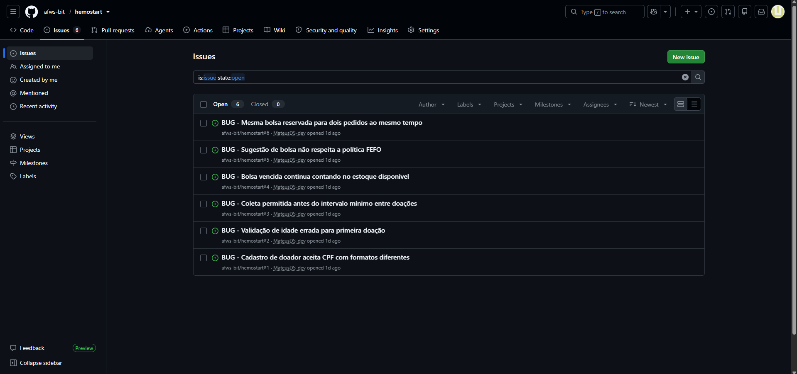

# 🩸 Rota Vital — Sistema de Gestão de Banco de Sangue

> Projeto da disciplina **Programação Orientada a Objetos (POO) — CESAR School 2026.2** · Equipe **Hemostart**
>
> 🌎 Deploy: https://hemostart-rotavital-api.onrender.com/

## 📌 Descrição do projeto

O **Rota Vital** é uma aplicação web que armazena, controla e distribui bolsas de sangue de forma segura e rastreável, conectando **doadores**, **estoque** e **hospitais**.

O problema: bancos de sangue ainda controlam estoque e pedidos em planilhas, o que gera bolsas vencendo na prateleira, falta de tipos raros sem aviso prévio e pouca rastreabilidade de quem recebeu cada bolsa. O Rota Vital resolve isso com:

- cadastro de doadores com regras de elegibilidade (idade, peso, intervalo entre doações);
- registro de coletas com código único e validade calculada automaticamente;
- painel de estoque por tipo sanguíneo com **alerta de estoque crítico**;
- validação automática de **compatibilidade ABO/Rh** e sugestão de bolsas por **FEFO** (vence primeiro, sai primeiro);
- fila de solicitações de hospitais com **prioridade para urgências**;
- distribuição com rastreio completo (coleta → reserva → distribuição/descarte) e relatórios por período.

## 🛠️ Tecnologias usadas

| Camada | Tecnologia |
|---|---|
| Linguagem | Java 17 |
| Framework | Spring Boot 3.2 (Spring MVC, Spring Data JPA, Scheduling) |
| Interface web | Thymeleaf + HTML + CSS |
| Banco de dados | **PostgreSQL 15** (Docker / Render) · **H2** (execução local e testes) |
| ORM | Hibernate / JPA |
| Build | Maven |
| Testes | JUnit 5 + Spring Boot Test (testes de unidade e de integração com banco) |
| Infra | Docker (multi-stage), Docker Compose, GitHub Actions (CI), Render (deploy) |
| Gestão | GitHub Issues (bug tracker), Figma (protótipo Lo-Fi) |

> ⚠️ Conforme exigido na disciplina, **não usamos Lombok** nem qualquer gerador de boilerplate: getters, setters, construtores, `equals`/`hashCode` foram escritos à mão.

## ▶️ Como rodar o projeto

### Opção 1 — Local, sem Docker (banco H2 em arquivo)

Pré-requisitos: **JDK 17+** e **Maven 3.9+**.

```bash
git clone https://github.com/afws-bit/hemostart.git
cd hemostart
mvn spring-boot:run
```

- Aplicação: http://localhost:8080
- Os dados ficam gravados em `./data/rotavital.mv.db` (sobrevivem ao reiniciar).
- Console do banco: http://localhost:8080/h2-console → JDBC URL `jdbc:h2:file:./data/rotavital`, usuário `sa`, senha vazia.
- Na primeira execução o sistema cria doadores, hospitais e bolsas de exemplo (desligue com `--rotavital.dados-iniciais=false`).

### Opção 2 — Docker Compose (API + PostgreSQL)

```bash
cp .env.example .env
docker compose up -d --build
```

A API sobe em http://localhost:8080 já conectada ao PostgreSQL (variáveis `SPRING_DATASOURCE_*` do `compose.yaml`).

### Rodar os testes

```bash
mvn test
```

Os testes de integração usam H2 em memória e sempre leem/gravam no banco: `HistoriasIntegracaoTest` (HU01–HU10 + rota da AED), `HistoriasNovasTests` (HU11–HU14, incluindo as telas via MockMvc) e `AedAlgoritmosTest` (algoritmos da AED).

## 🧱 Arquitetura e Orientação a Objetos

```
br.com.rotavital
├── model        Entidades JPA (Doador, Hospital, BolsaSangue, Requisicao, Agendamento, TriagemClinica,
│                HistoricoOperacao, Configuracao)
│                + enums de domínio (TipoSanguineo, Componente, StatusBolsa, StatusRequisicao, TipoOperacao)
├── repository   Interfaces Spring Data JPA (uma por entidade)
├── service      Regras de negócio / casos de uso (@Transactional)
├── controller   Controllers MVC (Thymeleaf) e endpoints REST de estatística
├── estruturas   Lista encadeada, fila com prioridade e pilha (AED U1)
├── aed          Matriz ABO/Rh, FEFO, hash, rota por vizinho mais próximo e alocador (AED U2)
├── scheduler    Verificação periódica de validade
├── config       Carga de dados iniciais e mapa de rotas
└── exception    RegraNegocioException
```

**Entidades persistidas (8):** `Doador`, `Hospital`, `BolsaSangue`, `Requisicao`, `Agendamento`, `TriagemClinica`, `HistoricoOperacao`, `Configuracao`.
Relacionamentos: `BolsaSangue → Doador` (N:1), `BolsaSangue → Hospital` destino (N:1), `BolsaSangue → Requisicao` (N:1), `Requisicao → Hospital` (N:1), `Agendamento → Doador` (N:1), `TriagemClinica → Doador` (N:1).

Princípios de POO aplicados:

- **Encapsulamento / modelo rico:** as transições de estado ficam na própria entidade (`bolsa.reservarPara()`, `bolsa.distribuir()`, `bolsa.descartar()`, `bolsa.atualizarValidade()`), que protege as invariantes — por exemplo, lança `RegraNegocioException("Bolsa já distribuída anteriormente")`.
- **Herança:** `Doador`, `Hospital`, `Requisicao`, `Agendamento`, `TriagemClinica` e `HistoricoOperacao` herdam de `EntidadeBase` (`@MappedSuperclass`), que gera o UUID e implementa `equals`/`hashCode`.
- **Polimorfismo / enums com comportamento:** `TipoSanguineo.podeDoarPara(receptor)` implementa a regra ABO/Rh; `Componente` sabe sua validade (42, 5 ou 365 dias).
- **Responsabilidade única e injeção de dependências por construtor:** controllers só tratam HTTP, services contêm regras, repositories acessam o banco.
- **Tratamento de erros com exceções** de domínio em vez de códigos de retorno.

## 👥 Equipe

| Nome completo | E-mail CESAR School |
|---|---|
| Augusto Freitas | afws@cesar.school |
| Caio Catão | cczc@cesar.school |
| Daniel Luiz | ddlmsf@cesar.school |
| Elisa Martins | emgs2@cesar.school |
| Glauberson | _preencher_@cesar.school |
| João Lucas | jlms@cesar.school |
| Kelly Melo | kpsm@cesar.school |
| Mateus Henrique Diniz | _preencher_@cesar.school |

### Membros anteriores / novos

| Nome completo | E-mail CESAR School | Entrada | Saída |
|---|---|---|---|
| _Nenhuma alteração na equipe até o momento_ | — | — | — |

---

# 📦 Entregas — POO

## Entrega 01 (31/08)

- 📄 [Histórias de usuário com cenários BDD (HU01–HU10)](docs/historias-usuario-rota-vital.md)
- 🎨 [Protótipo Lo-Fi no Figma](https://www.figma.com/proto/CBJbIvf3z3tfEXEEG7daIm/rascunho-rota-vital?t=cgiM3bFyiB5J0S8J-1)
- 🎥 [Screencast do protótipo](https://youtu.be/VbNkdUrYwnA?si=KJtaPPikWFK2a72j)

## Entrega 02 (21/09)

### Histórias implementadas

> **HU01 — Cadastro de Doador**
> Como **atendente**, quero **cadastrar doadores com CPF, nascimento, tipo sanguíneo e peso**, para **ter um registro confiável de quem pode doar**.
> ✔ CPF único · ✔ idade 16–69 anos · ✔ peso mínimo 50 kg

> **HU02 — Registro de Coleta**
> Como **enfermeiro**, quero **registrar a bolsa coletada vinculada ao doador**, para **que ela entre no estoque e seja rastreável**.
> ✔ código único BS-xxxxx · ✔ validade automática por componente · ✔ intervalo mínimo 60/90 dias

- 📄 [Histórias atualizadas (HU09 e HU10 adicionadas)](docs/historias-usuario-rota-vital.md)
- 🐞 Issue tracker:

  

- 🎥 Screencast do sistema rodando: https://youtu.be/wTMYO7UHukY
- 🎥 Screencast do código: https://youtu.be/0rAuU5NEjrw

## Entrega 03 (19/10)

### Histórias implementadas

> **HU03 — Controle de Estoque por Tipo Sanguíneo**
> Como **gestor**, quero **ver as bolsas por tipo e status**, para **decidir rapidamente sobre reposição e distribuição**.
> ✔ painel com os 8 tipos · ✔ vencidas mudam de status automaticamente

> **HU04 — Validação de Compatibilidade Sanguínea**
> Como **sistema**, quero **validar a compatibilidade ABO/Rh entre bolsa e paciente**, para **liberar apenas bolsas seguras**.
> ✔ tabela oficial de compatibilidade · ✔ sugestão FEFO · ✔ bloqueio de tipo incompatível

> **HU05 — Solicitação de Sangue por Hospital**
> Como **hospital cadastrado**, quero **solicitar bolsas informando tipo, quantidade e urgência**, para **ser atendido conforme a necessidade clínica**.
> ✔ só hospitais ativos · ✔ urgentes no topo da fila

- 🐞 Issue tracker: **_adicionar print_** → salvar como `docs/img/issues-entrega03.png` e trocar esta linha por ``
- 🎥 Screencast do sistema (novas histórias): **_adicionar link do YouTube_**
- 🎥 Screencast do código: **_adicionar link do YouTube_**

## Entrega 04 (09/11)

### Histórias implementadas

> **HU06 — Distribuição e Rastreio de Bolsas**
> Como **operador logístico**, quero **registrar a saída da bolsa vinculada ao pedido**, para **rastrear cada bolsa da coleta até a entrega**.
> ✔ data, hora, responsável e hospital destino · ✔ bloqueio de distribuição duplicada

> **HU07 — Controle de Validade e Descarte**
> Como **gestor de qualidade**, quero **ser alertado sobre bolsas perto de vencer e descartar as vencidas**, para **evitar desperdício e uso indevido**.
> ✔ alerta “uso prioritário” (≤ 5 dias) · ✔ descarte com responsável

> **HU08 — Histórico e Relatório**
> Como **gestor**, quero **relatórios de coletas, distribuições e descartes por período**, para **acompanhar indicadores operacionais**.
> ✔ filtro por período, tipo sanguíneo e hospital

> **HU09 — Cadastro de Hospital**
> Como **administrador**, quero **cadastrar e ativar/inativar hospitais**, para **que apenas instituições autorizadas solicitem sangue**.
> ✔ CNPJ único · ✔ inativos não solicitam

> **HU10 — Alerta de Estoque Crítico**
> Como **gestor**, quero **definir um nível mínimo por tipo e ser alertado abaixo dele**, para **organizar campanhas de doação a tempo**.
> ✔ mínimo configurável e salvo no banco · ✔ alerta some quando o estoque normaliza

> **HU11 — Agendamento de Doação**
> Como **doador**, quero **agendar dia e horário para doar**, para **evitar filas e garantir atendimento**.
> ✔ limite de vagas por horário · ✔ respeita o intervalo mínimo · ✔ cancelamento libera a vaga

> **HU12 — Triagem Clínica Pré-Doação**
> Como **profissional de triagem**, quero **registrar peso, pressão, temperatura e hemoglobina**, para **liberar só doadores aptos**.
> ✔ hemoglobina mínima por sexo · ✔ coleta bloqueada para inaptos

> **HU13 — Aprovação e Recusa de Solicitações**
> Como **gestor**, quero **aprovar ou recusar cada solicitação**, para **controlar a saída de bolsas**.
> ✔ aprovação reserva bolsas compatíveis (FEFO + rota) · ✔ recusa exige motivo e fica no histórico

> **HU14 — Histórico e Próxima Data Apta do Doador**
> Como **atendente**, quero **ver as doações de um doador e quando ele pode doar de novo**, para **orientar o agendamento**.
> ✔ lista de doações · ✔ próxima data apta (60/90 dias)

**Persistência:** todas as histórias leem e gravam no banco de dados relacional (PostgreSQL em produção / H2 local) via Spring Data JPA.

- 🐞 Issue tracker: **_adicionar print_** → salvar como `docs/img/issues-entrega04.png` e trocar esta linha por ``
- 🎥 Screencast do sistema (ênfase nas novas histórias): **_adicionar link do YouTube_**
- 🎥 Screencast do código: **_adicionar link do YouTube_**

## Apresentação final (09/11 a 13/11)

- 🎤 Slides / vídeo da apresentação: **_adicionar link_**

---

# 📚 Outras disciplinas do Projeto Integrador

| Disciplina | Contribuição no projeto |
|---|---|
| Projeto | Levantamento de requisitos, histórias de usuário e BDD |
| Programação Orientada a Objetos | Modelagem e implementação das entidades do sistema |
| Algoritmos e Estruturas de Dados | Estruturas para controle de estoque e compatibilidade |
| Estatística e Probabilidade | Indicadores de estoque/demanda e análise probabilística de desabastecimento e descarte |
| Infraestrutura de Software (SO) | Ambiente de execução e implantação |
| Infraestrutura de Comunicação (RSD) | Comunicação entre sistema e hospitais |

### 🧮 AED — Unidades 1 e 2 (C++ + Java + tradução comentada)

- 📄 **[Tradução comentada C++ ↔ Java e análise de complexidade](docs/aed/traducao-comentada.md)**: lista, fila e pilha (U1); matriz ABO/Rh, FEFO, hash e vizinho mais próximo (U2).
- **C++** (raiz do repo): `ListaEstoque`, `FilaRequisicoes`, `PilhaHistorico`, `Compatibilidade`, `FilaFEFO`, `TabelaHash`, `Grafo` e `Alocador` (integração).
  ```bash
  g++ -std=c++17 -Wall main.cpp -o hemostart && ./hemostart   # demonstração + 24 verificações automáticas
  ```
- **Java** (`src/main/java/br/com/rotavital/aed` e `estruturas`): mesma lógica, integrada à aplicação. Em **Requisições → Reservar**, o pedido recebe a bolsa compatível que vence primeiro e a rota calculada. Testes em `AedAlgoritmosTest`.

### Relatório de Algoritmos e Estrutura de Dados U1

https://docs.google.com/document/d/1pvN2DdHupPwdKikVTwpOW34SZLH7y-uA_THajAqoH8A/edit?tab=t.0

### Apresentação de Estatística

https://www.youtube.com/watch?v=-s2cwjNmQJ8

## 🎓 Infraestrutura de Software - Unidade 1 (U1)

---

### 1. Atividade Prática: Mesa DJ (Concorrência e Sincronização)

**Descrição:**  
Simulador de uma mesa de DJ controlada via terminal, onde cada instrumento é executado em uma Thread independente, permitindo a reprodução simultânea de múltiplas faixas de áudio com o Pygame.

**Tecnologias:** Python 3.12 + Pygame.

🔗 **Link do Repositório:** [Clique aqui para acessar o projeto Mesa DJ](https://github.com/MateusDS-dev/mesa_dj)

### 2. Módulo de Paralelismo: Threads II (Projeto Hemostart)

**Descrição:**  
Aceleração de uma operação CPU-bound (Validação em Lote de Compatibilidade Sanguínea ABO+Rh) utilizando processamento paralelo com ExecutorService e Virtual Threads do Java 21 (Project Loom).

**Tecnologias:** Java 21 + Spring Boot 3.2 + Maven + JUnit 5.

🔗 **Link do Repositório:** [Clique aqui para acessar o projeto Threads II (Hemostart)](https://github.com/MateusDS-dev/trhds2.git)


## 🎓 Infraestrutura de Software - Unidade 2 (U2)

**URL Pública (Deploy):** https://hemostart-rotavital-api.onrender.com/

## 🐳 E1 · Container Automatizado (Projeto RotaVital / HemoStart)

Este repositório contém a implementação do **Container Automatizado (E1)** para o Projeto Integrador. O objetivo principal é garantir que a aplicação suba do zero, em qualquer máquina, com um único comando, mantendo o ambiente de desenvolvimento idêntico ao de produção.

### ⚡ Como rodar o projeto do zero

Para subir toda a infraestrutura (API Spring Boot + Banco de Dados PostgreSQL), basta ter o Docker e o Docker Compose instalados e executar o comando abaixo na raiz do projeto:

```bash
docker compose up -d --build
```

> A API estará disponível em `http://localhost:8080`.

---

### 📂 Arquivos de Configuração

#### 1. `Dockerfile` (Multi-stage Build)
O arquivo foi dividido em dois estágios para otimizar a imagem final e proteger o código-fonte.

```dockerfile
# ==========================================
# Estágio 1: Build (Ambiente de Compilação)
# ==========================================
FROM maven:3.9-eclipse-temurin-17 AS build
WORKDIR /app

# Copia apenas o pom.xml primeiro para aproveitar o cache de dependências do Docker
COPY pom.xml .
RUN mvn dependency:go-offline

# Copia o código-fonte e compila, pulando os testes (os testes rodam na esteira de CI)
COPY src ./src
RUN mvn clean package -DskipTests

# ==========================================
# Estágio 2: Run (Ambiente de Execução)
# ==========================================
FROM eclipse-temurin:17-jre-alpine
WORKDIR /app

# Copia APENAS o artefato final do estágio de build
COPY --from=build /app/target/*.jar app.jar

EXPOSE 8080
ENTRYPOINT ["java", "-jar", "app.jar"]
```

#### 2. `compose.yaml` (Orquestração)
Define a rede, o banco de dados, a API e a persistência de dados.

```yaml
services:
  db:
    image: postgres:15-alpine
    container_name: rotavital_db
    environment:
      POSTGRES_USER: ${DB_USER}
      POSTGRES_PASSWORD: ${DB_PASSWORD}
      POSTGRES_DB: ${DB_NAME}
    volumes:
      - db_data:/var/lib/postgresql/data # Volume nomeado para persistência
    healthcheck:
      test: ["CMD-SHELL", "pg_isready -U ${DB_USER} -d ${DB_NAME}"]
      interval: 5s
      timeout: 5s
      retries: 5
    networks:
      - rotavital_network

  api:
    build: . 
    container_name: rotavital_api
    ports:
      - "8080:8080"
    environment:
      - SPRING_DATASOURCE_URL=jdbc:postgresql://db:5432/${DB_NAME}
      - SPRING_DATASOURCE_USERNAME=${DB_USER}
      - SPRING_DATASOURCE_PASSWORD=${DB_PASSWORD}
    depends_on:
      db:
        condition: service_healthy # Só inicia a API após o banco estar pronto
    networks:
      - rotavital_network

volumes:
  db_data:

networks:
  rotavital_network:
    driver: bridge
```

#### 3. `.env.example` (Configuração Fora do Código)

```env
DB_USER=admin_rotavital
DB_PASSWORD=senha_segura_123
DB_NAME=rotavital_db
```

---

### 🧠 Justificativas Técnicas (Critérios de Avaliação)

Para atender aos requisitos da disciplina, abaixo estão as justificativas das decisões de infraestrutura tomadas:

> **1. Por que usamos Multi-stage Build?**
> Para separar o ambiente de *build* (que exige Maven, JDK completo e baixa muitos pacotes) do ambiente de *execução* (que só precisa do JRE). O resultado é uma imagem final extremamente enxuta, mais rápida de ser baixada em produção e mais segura (pois não contém o código-fonte original ou ferramentas de compilação).
> 
> **2. Escolha da Imagem Base (Tamanho e Segurança)**
> No estágio de execução, utilizamos `eclipse-temurin:17-jre-alpine`. A distribuição **Alpine Linux** foi escolhida por ser notoriamente leve. Isso reduz o tamanho total da imagem da nossa API drasticamente (de ~800MB para menos de 200MB). Além disso, por ter menos bibliotecas do sistema operacional instaladas, a superfície de ataque contra vulnerabilidades é reduzida.
> 
> **3. Onde ficam os dados? (Volume)**
> O PostgreSQL salva os dados nativamente em `/var/lib/postgresql/data`. No Compose, mapeamos esse diretório para um **Volume Nomeado** (`db_data`). Isso garante a persistência: se rodarmos `docker compose down` e subirmos novamente, os dados dos doadores e do estoque de sangue não serão perdidos.
> 
> **4. Como os serviços se encontram? (Rede do Compose)**
> Criamos uma rede customizada *bridge* (`rotavital_network`). O Docker cria um DNS interno para essa rede. Por isso, a API encontra o banco de dados usando a URL `jdbc:postgresql://db:5432/...` (onde `db` é o nome do serviço definido no compose). Para garantir a ordem de inicialização, usamos o `depends_on` aliado a um `healthcheck` no banco, impedindo que a API suba antes do banco estar pronto para receber conexões.

---

### 📸 Evidências de Execução


- [x] **Print 1:** Terminal executando o comando `docker compose up -d --build` com sucesso.
- [x] **Print 2:** Terminal executando `docker ps` mostrando os containers `rotavital_api` e `rotavital_db` (com status *healthy*).
- [x] **Print 3:** Navegador acessando `http://localhost:8080` exibindo a tela do sistema (Painel Geral), provando que a API e o Banco estão se comunicando.

### 🧪 E2 · TDD (Test-Driven Development)

#### Story Map (Release 1)
1. **História: Validação de Compatibilidade Sanguínea**
   - Tarefas: Criar Enum de tipos; Implementar lógica de compatibilidade (Regra de negócio crítica); Escrever teste unitário.
2. **História: Cadastro de Doador**
   - Tarefas: Criar entidade e repositório; Criar endpoint e validações; Testes de integração com banco de dados.
3. **História: Alerta de Estoque Crítico e FEFO**
   - Tarefas: Query de contagem; Regra de negócio para disparar alerta; Lógica para ordenar bolsas por vencimento.

#### Testes por Nível
- **Unitários:** Focados na regra de negócio de compatibilidade (ex: garantir que O- doa para A+, mas A+ não doa para O-).
- **Integração:** Uso de `@SpringBootTest` para validar a comunicação entre o Service e o Banco de Dados.
- **Aceitação (BDD):** Cenários documentando o fluxo do usuário (ex: priorização de bolsas vencendo).

#### Histórico Red -> Green
O histórico de commits comprova o TDD. 
- `test: forçando falha no pipeline para gerar evidencia Red`
- `fix: corrigindo teste e restaurando pipeline verde`

#### Justificativas de TDD
- **Quais regras ganharam teste primeiro e por quê?** A validação de compatibilidade (ABO/Rh). **Motivo:** Risco à vida do paciente. 
- **O que ficou sem teste?** Os Controllers de CRUD simples, pois são validados indiretamente pelos testes de integração.
- **Pipeline CI:** O GitHub Actions (`.github/workflows/ci.yml`) roda o `mvn test` a cada push/PR. Teste vermelho barra o merge (Quality Gate).

---

### 🚀 E3 · Deploy Automatizado

- **Provedor de Deploy:** Utilizamos o **Render** (plano Free) pela integração nativa com Docker e GitHub.
- **Pipeline e Fluxo de Branch (GitHub Flow):** A branch `main` é protegida. O fluxo é: `feature/*` -> Pull Request -> Pipeline (E2) roda -> Se verde, faz merge na `main` -> Render detecta e faz o deploy.
- **Deploy Automático:** O Render está configurado para a branch `main` usando o `Dockerfile`. A cada merge, o build e o deploy ocorrem sozinhos.
- **Segredos (Secrets):** As credenciais do PostgreSQL não estão no código. Elas foram cadastradas no painel de *Environment Variables* do Render.
- **Rollback:** Caso um deploy dê problema, o rollback é feito via `git revert` (disparando novo deploy automatizado) ou em 1 clique no histórico de deploys do próprio painel do Render.

## 📐 U2 · Parte 2: Planejamento da Remodelagem (DDD e Arquitetura)

Esta seção documenta a entrega da **Parte 2** do Projeto Integrador: o planejamento da remodelagem do Rota Vital com Domain-Driven Design (DDD), Arquitetura em Três Camadas, projeção para Microsserviços e simulação de orçamento em nuvem.

> 📁 **Documentação Técnica Completa:** Todos os diagramas, planilhas de orçamento e registros de decisões (ADRs) estão disponíveis na pasta [`docs/arquitetura/`](./docs/arquitetura/).

### A. Remodelagem do Domínio com DDD

#### 1. Classificação dos Subdomínios
*   **Core (Núcleo):** Gestão de Estoque de Sangue. *Justificativa: É o coração do sistema, onde residem as regras de negócio críticas (compatibilidade ABO/Rh, validade e FEFO) que trazem vantagem competitiva e salvam vidas.*
*   **Suporte:** Requisição Hospitalar e Expedição. *Justificativa: Apoiam diretamente o core, mas suas regras são mais padronizadas (fluxo de pedido e logística).*
*   **Genérico:** Notificação (E-mail/SMS). *Justificativa: Pode ser resolvido com soluções de mercado (SaaS) e não contém regras de negócio específicas do hemocentro.*

#### 2. Bounded Contexts (Contextos Delimitados)
1.  **Estoque:** Responsável por armazenar, validar a compatibilidade e controlar a validade das bolsas de sangue.
2.  **Requisição:** Gerencia os pedidos de sangue realizados pelos hospitais e a fila de prioridade.
3.  **Expedição:** Cuida da separação física, embalagem e rastreio logístico da bolsa até o destino.
4.  **Telemetria:** Monitora a temperatura e a integridade das bolsas durante o transporte.

#### 3. Linguagem Ubíqua (Glossário)
Acesse o glossário completo em [`docs/arquitetura/glossario.md`](./docs/arquitetura/glossario.md).
*Destaque para o termo com duplo sentido:*
*   **"Bolsa" (Contexto de Estoque):** Refere-se ao volume de hemocomponente armazenado, com tipagem sanguínea e data de validade.
*   **"Bolsa" (Contexto de Expedição):** Refere-se ao item logístico (pacote) que deve ser embalado, etiquetado e despachado, focado no peso e acondicionamento térmico.

#### 4. Mapa de Contextos (Context Map)
*   **Expedição -> Estoque:** Relação **Cliente-Fornecedor** (Customer-Supplier). A Expedição solicita a reserva, o Estoque valida e fornece.
*   **Requisição -> Estoque:** Relação **Camada Anticorrupção (ACL)**. O sistema do hospital envia o pedido em um formato externo, e a ACL traduz para o modelo de domínio do Estoque do Rota Vital.

### B. Modelo Tático (Contexto Core: Estoque)

*   **Agregado:** `BolsaSanguinea`.
    *   **Raiz:** `BolsaSanguinea`.
    *   **Entidades:** `Doador` (referenciado por ID).
    *   **Objetos de Valor:** `TipoSanguineo` (ABO/Rh), `DataValidade`, `StatusBolsa` (Disponível, Reservada, Expirada).
    *   **Invariante protegida:** *Uma bolsa não pode ser reservada/expedida se estiver fora do prazo de validade ou se o tipo sanguíneo não for compatível com o receptor.*
*   **História de Usuário Âncora:** "Como enfermeiro(a), quero registrar uma nova bolsa de sangue para que ela entre no estoque disponível e o sistema alerte antes do vencimento."
*   **Cenário Gherkin:** O arquivo com o cenário (Dado/Quando/Então) a ser executado na Parte 3 está em [`src/test/resources/features/registrar_bolsa.feature`](./src/test/resources/features/registrar_bolsa.feature).

### C. Arquitetura em Três Camadas

Adotamos a separação lógica baseada nos *Bounded Contexts*.

*   **Apresentação:** Controllers REST e telas (ex: `EstoqueController`).
*   **Negócio (Domínio + Aplicação):** Casos de uso (ex: `RegistrarBolsaUseCase`) e o modelo rico (ex: `BolsaSanguinea`).
*   **Dados:** Repositórios JPA e integrações externas.
*   **Regra de Dependência:** O domínio não conhece o framework web nem o banco (Inversão de Dependência).
*   **Lógico x Físico:** Todas as três camadas estão no mesmo *tier* físico (Monolito Modular) na Parte 2, rodando no mesmo container.

### Estrutura de pacotes atual (Monolito da Parte 1):
*(Reflete a estrutura real do código entregue até o momento)*

```text
br.com.rotavital
├── controller (EstoqueController, RequisicaoController...)
├── service (EstoqueService, CompatibilidadeService...)
├── repository (Spring Data JPA: DoadorRepository, BolsaSangueRepository...)
├── aed (MatrizCompatibilidade, FilaFEFO, TabelaHashEstoque, GrafoRotas, AlocadorBolsas)
├── model (BolsaSangue, Doador, Requisicao...)
└── dto
```
### Estrutura de pacotes proposta(parte 2):

```text
br.com.rotavital
├── estoque
│   ├── apresentacao (EstoqueController)
│   ├── negocio
│   │   ├── aplicacao (RegistrarBolsaUseCase)
│   │   └── dominio (BolsaSanguinea, TipoSanguineo)
│   └── dados (BolsaRepositoryJpa)
├── requisicao
└── expedicao
```

### 🤖 Uso de Inteligência Artificial

O uso de IA foi permitido e declarado. **A ferramenta utilizada foi o DeepSeek (Chat)**. Ela foi empregada como uma assistente de produtividade para:
- Auxiliar na estruturação inicial do `Dockerfile` e do `compose.yaml`.
- Gerar o *boilerplate* dos testes JUnit e a sintaxe YAML do GitHub Actions.
- Ajudar na formatação em Markdown deste README.

**Revisão:** Todo o código e texto gerados pela IA foram revisados, executados localmente e compreendidos pela equipe antes de serem commitados, garantindo a integridade do projeto.

---

### 📊 Tabela de Decisões

| Decisão | Opções comuns | Justificativa da nossa escolha |
| :--- | :--- | :--- |
| **Imagem base** | `node:22-alpine`, `eclipse-temurin:17-jre` | Usamos `alpine` pois é menor e tem menos pacotes vulneráveis. A compilação fica no 1º estágio (multi-stage) com o Maven. |
| **Dados** | PostgreSQL, MySQL, MongoDB | Escolhemos **PostgreSQL**. Persistência garantida via **volume nomeado**, pois os dados sobrevivem ao `docker compose down`. |
| **Testes** | Qual regra testar primeiro | **Compatibilidade ABO/Rh e FEFO**, pois o erro não é apenas um bug visual, mas um risco real ao paciente. |
