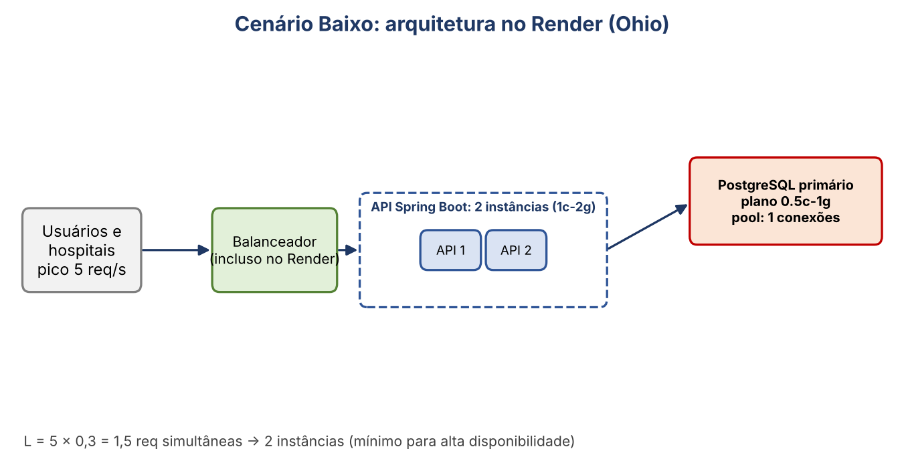
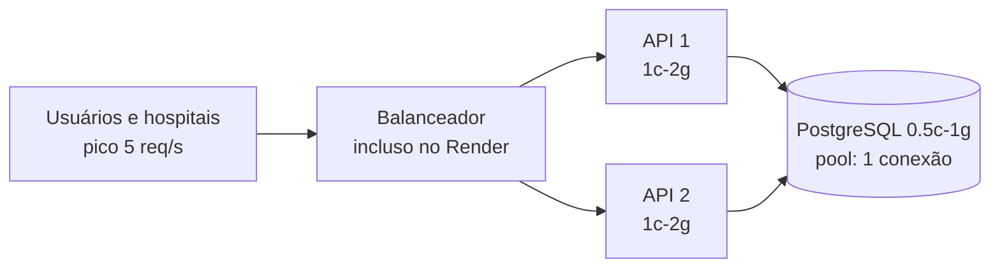
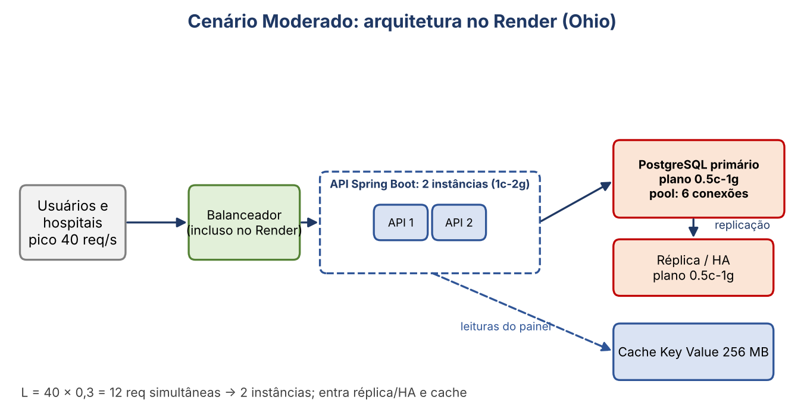
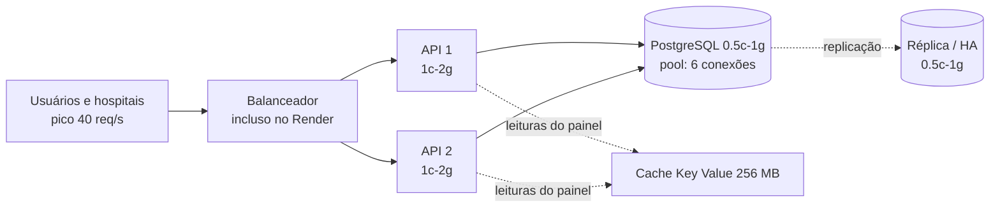
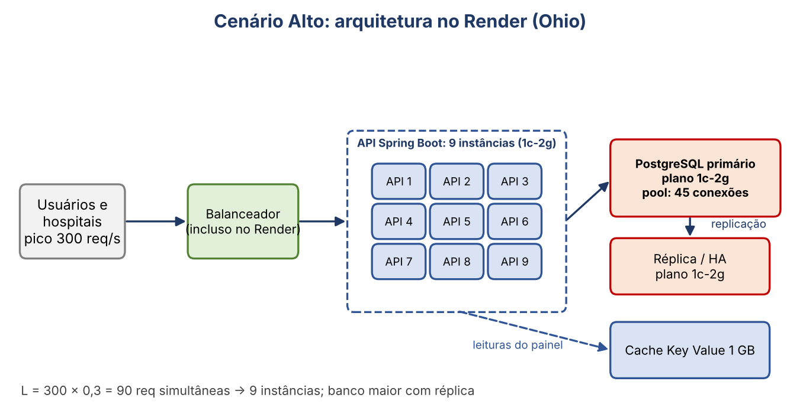
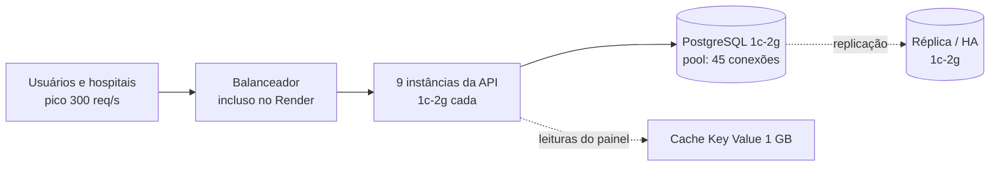

# Diagramas dos três cenários

Um diagrama por cenário, todos no Render (região Ohio), com os planos da planilha de orçamento. Os números vêm da aba Little: pico (λ), requisições simultâneas (L = λ × W, com W = 0,3 s), instâncias adotadas e pool de conexões.

## Cenário baixo: λ = 5 req/s, L = 1,5, 2 instâncias, pool de 1 conexão

## Cenário moderado: λ = 40 req/s, L = 12, 2 instâncias, pool de 6 conexões

## Cenário alto: λ = 300 req/s, L = 90, 9 instâncias, pool de 45 conexões

## O que muda de um cenário para o outro

| | Baixo | Moderado | Alto |
|---|---|---|---|
| Instâncias da API | 2 | 2 | 9 |
| Banco | `0.5c-1g` | `0.5c-1g` + réplica/HA | `1c-2g` + réplica/HA |
| Cache | não tem | Key Value 256 MB | Key Value 1 GB |
| Armazenamento do banco | 10 GB | 50 GB | 200 GB |
| Pool de conexões | 1 | 6 | 45 |
