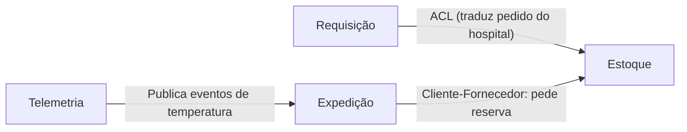

# Mapa de Contextos

| Relação | Padrão | Descrição |
|---|---|---|
| Requisição → Estoque | Camada Anticorrupção (ACL) | O pedido do hospital chega em formato externo; a ACL traduz para o modelo do Estoque (tipo do receptor, quantidade). |
| Expedição → Estoque | Cliente-Fornecedor | A Expedição solicita a reserva; o Estoque valida e fornece. |
| Telemetria → Expedição | Publisher-Subscriber | A Telemetria publica leituras; a Expedição reage a violações da cadeia fria. |

## Eventos de domínio (opcional)
| Evento | Publica | Consomem |
|---|---|---|
| `BolsaReservada` | Estoque | Requisição, Expedição |
| `BolsaDistribuida` | Estoque | Requisição |
| `BolsaVencida` | Estoque | Requisição |
| `ReservaLiberada` | Estoque | Requisição |
| `CadeiaFriaViolada` | Telemetria | Expedição, Estoque |