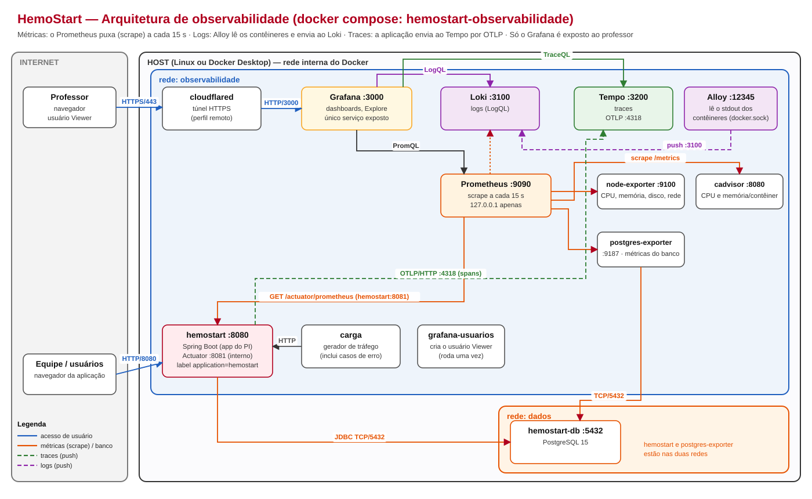

# Observabilidade do HemoStart — Actuator, Prometheus, Grafana, Loki e Tempo

> **Infraestrutura de Comunicação (RSD) · Unidade 2 · Projeto de Avaliação (6,0 + 1,0)**
> Aplicação instrumentada: **HemoStart / Rota Vital** (Spring Boot 3.2, Java 17), a aplicação web Java do Projeto Integrador.



## 1. O que sobe com um comando

| Serviço | Imagem | Porta | Acesso | Função |
|---|---|---|---|---|
| `hemostart` | build do `Dockerfile` da raiz | 8080 (app) · 8081 (Actuator) | 8080 publicada; **8081 só na rede interna** | Aplicação do PI |
| `hemostart-db` | postgres:15-alpine | 5432 | interna (rede `dados`) | Banco da aplicação |
| `carga` | python:3.12-alpine | — | interna | Gera tráfego contínuo, inclusive erros |
| `prometheus` | prom/prometheus:v2.54.1 | 9090 | só `127.0.0.1` da máquina | Coleta de métricas |
| `node-exporter` | prom/node-exporter:v1.8.2 | 9100 | interna | Métricas do host |
| `cadvisor` | gcr.io/cadvisor/cadvisor:v0.49.1 | 8080 | interna | Métricas por contêiner |
| `postgres-exporter` | prometheuscommunity/postgres-exporter:v0.15.0 | 9187 | interna | Métricas do PostgreSQL (opcional R3) |
| `loki` | grafana/loki:3.2.1 | 3100 | interna | Logs |
| `alloy` | grafana/alloy:v1.4.3 | 12345 | interna | Lê os logs dos contêineres e envia ao Loki |
| `tempo` | grafana/tempo:2.6.1 | 3200 · 4318 (OTLP) | interna | Traces |
| `grafana` | grafana/grafana:11.2.0 | 3000 | **publicada** | Dashboards e Explore |
| `grafana-usuarios` | curlimages/curl | — | interna | Cria o usuário Viewer do professor e termina |
| `cloudflared` *(perfil `remoto`)* | cloudflare/cloudflared | — | saída HTTPS | Túnel público só para o Grafana |
| `verificador` *(perfil `verificar`)* | python:3.12-alpine | — | interna | Confere o checklist e gera evidências |

## 2. Pré-requisitos

- Docker com Docker Compose v2 (`docker compose version`)
- ~4 GB de RAM livres (a aplicação Java e a stack somam cerca de 2,5 GB)
- Portas 8080 e 3000 livres

> **Docker Desktop (Windows/macOS):** Node Exporter e cAdvisor medem a máquina virtual do Docker, não o computador.
> Isso é aceito pelo professor desde que explicado no PDF. Se o `node-exporter` não subir no macOS, troque
> `/:/host:ro,rslave` por `/:/host:ro` no `docker-compose.yml`.

## 3. Como subir

### Jeito rápido (recomendado): um comando faz tudo

Cria o `.env` com senhas aleatórias, sobe o ambiente com o túnel, espera a aplicação ficar saudável, roda o
verificador e mostra a URL e o login do professor (salvos também em `.acesso-professor.txt`, fora do Git).

| Sistema | Comando (dentro da pasta `observabilidade`) |
|---|---|
| Windows (PowerShell) | `powershell -ExecutionPolicy Bypass -File .\subir.ps1` |
| Linux, macOS ou WSL | `bash subir.sh` |

Depois, abra `docs/evidencias/links-para-prints.md`: cada print tem um link pronto para a tela certa.

### Verificador do checklist

`docker compose run --rm verificador` confere 19 itens (Actuator, métricas padrão e de negócio, Actuator fora da
porta pública, 8 alvos UP, PromQL com dados, datasources, dashboards, usuário Viewer, logs no Loki com traceId e
trace com vários spans no Tempo). Ele grava `verificacao.txt`, `actuator-prometheus.txt`, `prometheus-targets.txt`
e `links-para-prints.md` em `docs/evidencias/`. Nenhuma senha é gravada.

### Passo a passo manual

```bash
cd observabilidade
cp .env.example .env          # edite e troque TODAS as senhas
docker compose up -d --build  # primeira vez demora (compila a aplicação)
docker compose ps             # todos "running"; hemostart "healthy"; grafana-usuarios "exited (0)"
```

Para liberar o acesso remoto do professor (seção 6):

```bash
docker compose --profile remoto up -d
docker compose logs cloudflared | grep trycloudflare     # mostra a URL pública https://....trycloudflare.com
```

Para desligar: `docker compose --profile remoto down` (os dados ficam nos volumes; `down -v` apaga tudo).

## 4. URLs e verificações

| O que | Onde | O que conferir |
|---|---|---|
| Aplicação | <http://localhost:8080> | Telas do sistema |
| Métricas da aplicação | `docker compose exec prometheus wget -qO- http://hemostart:8081/actuator/prometheus \| grep hemostart_` | Métricas com `application="hemostart"` |
| Prometheus | <http://localhost:9090/targets> | 8 alvos em **UP** |
| Grafana | <http://localhost:3000> (admin e senha do `.env`) | Pasta *Projeto Integrador - HemoStart* com 2 dashboards |
| Logs | Grafana → Explore → Loki: `{application="hemostart"}` | Linhas com `[hemostart,<traceId>,<spanId>]` |
| Traces | Grafana → Explore → Tempo → Search, serviço `hemostart` | Trace de `POST /api/v1/coletas` com vários spans |

> O Actuator **não** é publicado: ele escuta na porta 8081, que só existe dentro da rede do Docker. Por isso a
> verificação acima é feita de dentro do contêiner do Prometheus. Em produção (Render) só `/actuator/health` existe.

Consultas PromQL úteis (Prometheus → Graph):

```promql
sum by (uri) (rate(http_server_requests_seconds_count{application="hemostart"}[1m]))
histogram_quantile(0.95, sum by (le) (rate(http_server_requests_seconds_bucket{application="hemostart"}[5m])))
hemostart_estoque_disponivel
sum by (tipo) (rate(hemostart_bolsas_coletadas_total[5m])) * 60
up
```

## 5. Instrumentação da aplicação

| Requisito | Como foi feito | Onde |
|---|---|---|
| R1 · Actuator + Prometheus | `spring-boot-starter-actuator` + `micrometer-registry-prometheus`; expõe `health, info, metrics, prometheus`; tag `application=hemostart` em todas as métricas | `pom.xml`, `application.properties` |
| R2 · Métricas padrão | HTTP (`http_server_requests_seconds` com histograma para p95/p99), JVM (heap, GC, threads), CPU, uptime, HikariCP | automático pelo Actuator |
| R5 · Segurança | Actuator na porta 8081, não publicada; em produção só `health`; senhas só no `.env` (fora do Git); Prometheus preso ao localhost | `docker-compose.yml`, `.gitignore` |
| R6 · Logs | Padrão de log com `[hemostart,traceId,spanId]`; Alloy lê o stdout e envia ao Loki com as labels `application`, `service`, `container` e `level` | `application.properties`, `alloy/config.alloy` |
| R6 · Traces | Micrometer Tracing + OpenTelemetry → OTLP/HTTP → Tempo; spans extras por camada (serviço, seção crítica, repositório) | `observabilidade/ObservabilidadeAspect.java` |
| R6 · Correlação | Loki → Tempo pelo campo derivado `TraceID`; Tempo → Loki pelo `traceId` | `grafana/provisioning/datasources/datasources.yml` |
| Caso de erro | `GET /api/teste/erro` gera HTTP 500 (só neste ambiente); o gerador de carga chama a cada ~30 s | `DiagnosticoApiController.java`, `carga/gerador_carga.py` |

Exemplo de trace (`POST /api/v1/coletas`):

```
http post /api/v1/coletas
  └─ EstoqueService.registrarColeta
       └─ SecaoCritica.executar                          (trava + transação)
            ├─ DoadorRepository.findById
            ├─ TriagemClinicaRepository.findTopByDoador_IdOrderByDataHoraDesc
            ├─ BolsaSangueRepository.findTopByOrderByCodigoDesc
            ├─ BolsaSangueRepository.save
            ├─ DoadorRepository.save
            └─ HistoricoService.registrar
                 └─ HistoricoOperacaoRepository.save
```

## 6. Métricas de negócio (ponto adicional)

Criadas com Micrometer em `MetricasNegocio.java` e alimentadas por um aspecto (`MetricasNegocioAspect.java`),
sem alterar os serviços. Todas aparecem no Prometheus e têm painéis próprios no dashboard de aplicação.

| Métrica no Prometheus | Tipo | O que mede |
|---|---|---|
| `hemostart_bolsas_coletadas_total{tipo, componente}` | counter | Bolsas registradas na coleta |
| `hemostart_bolsas_distribuidas_total{tipo}` | counter | Bolsas entregues aos hospitais |
| `hemostart_bolsas_descartadas_total{tipo}` | counter | Bolsas descartadas |
| `hemostart_solicitacoes_criadas_total{tipo, urgencia}` | counter | Pedidos de sangue recebidos dos hospitais |
| `hemostart_solicitacoes_decididas_total{resultado}` | counter | Pedidos aprovados ou recusados |
| `hemostart_alocacao_duracao_seconds{resultado}` | timer | Tempo para aprovar um pedido e reservar as bolsas (compatibilidade ABO/Rh + FEFO + rota) |
| `hemostart_estoque_disponivel{tipo}` | gauge | Bolsas disponíveis por tipo sanguíneo |
| `hemostart_solicitacoes_pendentes` | gauge | Pedidos aguardando decisão |

## 7. Dashboards (JSON versionado em `grafana/dashboards/`)

- **HemoStart — Aplicação:** visão geral (uptime, req/s, p95, % de 5xx, heap, conexões); HTTP por rota e status;
  JVM; pool HikariCP; tempo por camada (serviço e repositório); métricas de negócio; logs de aviso/erro e eventos de negócio.
- **HemoStart — Infraestrutura:** estado UP/DOWN de todos os alvos; CPU, memória, disco, rede e load do host;
  CPU, memória e rede por contêiner; PostgreSQL (conexões, tamanho, commits/s).

## 8. Acesso remoto do professor (E7)

- **Forma escolhida:** Cloudflare Tunnel rápido (`cloudflared`), gratuito, com HTTPS e sem abrir porta no roteador.
  Só o Grafana passa pelo túnel; Prometheus, Loki, Tempo e Actuator continuam internos.
- **Usuário:** criado automaticamente pelo serviço `grafana-usuarios` com papel **Viewer**, com login e senha do `.env`.
  **Informe as credenciais só no PDF ou no Classroom.**
- **Período:** deixar a máquina ligada com `docker compose --profile remoto up -d` durante a janela de correção.
  O gerador de carga mantém os gráficos com dados.
- A URL do túnel rápido muda se o contêiner `cloudflared` reiniciar: confira em `docker compose logs cloudflared`
  e, se mudar, avise o professor.

## 9. Evidências para o PDF (salvar em `docs/evidencias/`, com data e hora visíveis)

| # | Print | Arquivo sugerido |
|---|---|---|
| 1 | Terminal com `docker compose ps` | `01-compose-ps.png` |
| 2 | Saída de `/actuator/prometheus` filtrada por `hemostart_` | `02-actuator-prometheus.png` |
| 3 | Prometheus → Status → Targets, tudo UP | `03-targets-up.png` |
| 4 | Uma consulta PromQL com gráfico | `04-promql.png` |
| 5 | Dashboard de aplicação com dados | `05-dashboard-aplicacao.png` |
| 6 | Painéis de métricas de negócio | `06-metricas-negocio.png` |
| 7 | Dashboard de infraestrutura com dados | `07-dashboard-infra.png` |
| 8 | Explore → Loki com `{application="hemostart"}` | `08-loki-logql.png` |
| 9 | Um trace aberto no Tempo (vários spans) | `09-tempo-trace.png` |
| 10 | Navegação log → trace (botão "Abrir trace no Tempo") | `10-log-para-trace.png` |
| 11 | Grafana aberto pela URL pública, logado como Viewer | `11-acesso-remoto.png` |
| 12 | Trecho do código das métricas de negócio | `12-codigo-metricas.png` |

O texto do relatório já está em [`docs/relatorio.md`](docs/relatorio.md); falta só inserir os prints.
