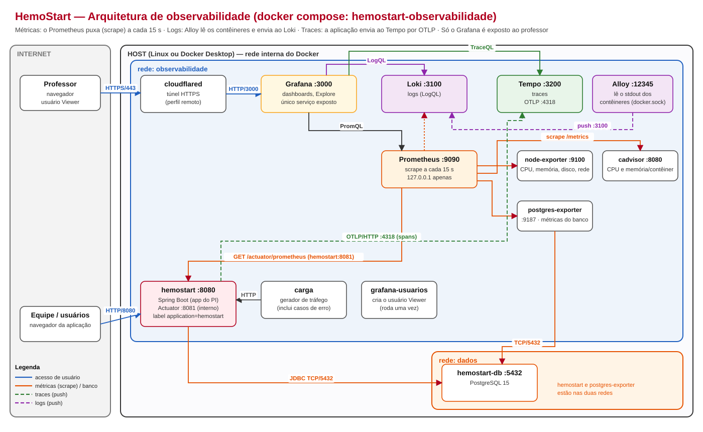

# Projeto de Avaliação — Infraestrutura de Comunicação
## Observabilidade com Actuator, Prometheus e Grafana — HemoStart / Rota Vital

| | |
|---|---|
| **Disciplina** | Infraestrutura de Comunicação (RSD) — Prof. Luiz Filipe Guimarães Novaes |
| **Equipe** | Grupo Hemostart (equipe 03) — Augusto Freitas Wanderley de Siqueira, Caio Catão Zenaide Costa, Daniel Luiz, Elisa Martins Galindo Santos, Glauberson, Igor Kauã de Souza Siqueira, João Lucas Mendes dos Santos, Kelly Priscilla de Siqueira Melo, Mateus Henrique Diniz Silva |
| **Repositório** | <https://github.com/afws-bit/hemostart> (pasta `observabilidade/`) |
| **Data** | _preencher_ |

---

## 1. Aplicação instrumentada

O **HemoStart (Rota Vital)** é a aplicação web Java do Projeto Integrador: um sistema de gestão de banco de sangue
(cadastro de doadores, triagem, coleta, estoque por tipo sanguíneo, compatibilidade ABO/Rh com política FEFO,
pedidos de hospitais, distribuição com rota de entrega e relatórios). É um monolito Spring Boot 3.2 / Java 17 com
interface Thymeleaf, API REST `/api/v1` e PostgreSQL 15.

O que foi instrumentado:

| Sinal | Como | Resultado |
|---|---|---|
| Métricas padrão | Spring Boot Actuator + Micrometer Prometheus, tag `application=hemostart` | HTTP (com histograma para p95/p99), JVM, CPU, uptime, HikariCP |
| Métricas de negócio | 8 métricas Micrometer (counters, timer e gauges) | Coletas, pedidos, aprovações, tempo de alocação, estoque por tipo |
| Logs | Padrão de log com `[hemostart,traceId,spanId]`, coletados do stdout pelo Grafana Alloy | Loki, filtrável por `application`, `service`, `container` e `level` |
| Traces | Micrometer Tracing + OpenTelemetry (OTLP/HTTP) e spans por camada criados por um aspecto | Tempo, com controller → serviço → seção crítica → repositório |
| Infraestrutura | Node Exporter, cAdvisor e postgres_exporter | Host, contêineres e banco |

## 2. Diagrama da arquitetura

Fluxo: o **Prometheus** faz *scrape* a cada 15 s de `hemostart:8081/actuator/prometheus` e dos exporters
(`node-exporter:9100`, `cadvisor:8080`, `postgres-exporter:9187`), além de Loki, Tempo e Alloy. A aplicação envia
os spans ao **Tempo** por OTLP/HTTP na porta 4318. O **Alloy** lê pelo socket do Docker o stdout de todos os
contêineres do projeto e envia ao **Loki** (porta 3100). O **Grafana** consulta Prometheus (PromQL), Loki (LogQL) e
Tempo (TraceQL) e é o **único** serviço exposto, pelo túnel da Cloudflare.

| Serviço | Porta | Exposição |
|---|---|---|
| Grafana | 3000 | Publicada e acessível pelo túnel HTTPS |
| Aplicação | 8080 | Publicada (é o produto) |
| Actuator | 8081 | Somente rede interna do Docker |
| Prometheus | 9090 | Somente `127.0.0.1` da máquina |
| Loki, Tempo, Alloy, exporters, PostgreSQL | 3100, 3200/4318, 12345, 9100, 8080, 9187, 5432 | Somente rede interna |

## 3. Stack escolhida

Usamos a **stack padrão** (Prometheus + Grafana), então a justificativa não é obrigatória. Para os logs usamos
o **Grafana Alloy** no lugar do Promtail, porque o Promtail foi descontinuado pela Grafana Labs (fim do suporte
em 2026) e o Alloy é o coletor recomendado. Ele descobre os contêineres pelo `docker.sock` sem mudar a aplicação.

## 4. Segurança mínima (R5)

- O Actuator escuta na porta de gerenciamento **8081**, que não é publicada pelo Compose. Na produção (Render)
  a configuração padrão expõe apenas `/actuator/health`, na mesma porta da aplicação.
- O Prometheus é publicado só em `127.0.0.1`; Loki, Tempo e exporters não têm porta publicada.
- As senhas (banco, admin do Grafana e Viewer do professor) ficam no `.env`, que está no `.gitignore`. O
  repositório só tem o `.env.example`. A senha padrão `admin/admin` não é usada: o Compose recusa subir sem
  `GRAFANA_ADMIN_PASSWORD`.
- Cadastro público e acesso anônimo do Grafana estão desligados.

## 5. Métricas de negócio (adicional)

| Métrica | Tipo | O que mede |
|---|---|---|
| `hemostart_bolsas_coletadas_total{tipo, componente}` | counter | Bolsas registradas na coleta |
| `hemostart_bolsas_distribuidas_total{tipo}` | counter | Bolsas entregues aos hospitais |
| `hemostart_bolsas_descartadas_total{tipo}` | counter | Bolsas descartadas |
| `hemostart_solicitacoes_criadas_total{tipo, urgencia}` | counter | Pedidos de sangue recebidos dos hospitais |
| `hemostart_solicitacoes_decididas_total{resultado}` | counter | Pedidos aprovados ou recusados |
| `hemostart_alocacao_duracao_seconds{resultado}` | timer | Tempo para aprovar um pedido e reservar as bolsas compatíveis (operação crítica) |
| `hemostart_estoque_disponivel{tipo}` | gauge | Bolsas disponíveis por tipo sanguíneo |
| `hemostart_solicitacoes_pendentes` | gauge | Pedidos aguardando decisão |

Implementação: `MetricasNegocio.java` registra as métricas no `MeterRegistry`; `MetricasNegocioAspect.java`
incrementa os contadores e mede o timer quando os serviços concluem cada operação, sem alterar o código dos
serviços. Os gauges leem o banco com SQL agregado e cache de 10 s.

_[Print 12 — trecho do código]_ · _[Print 6 — painéis de negócio com dados]_

## 6. Evidências

> Todos os prints com data e hora visíveis.

**6.1 `docker compose ps`** — _[Print 1]_

**6.2 `/actuator/prometheus` da aplicação, com a tag `application="hemostart"`** — _[Print 2]_

**6.3 Prometheus → Status → Targets, todos UP** — _[Print 3]_

**6.4 Consulta PromQL** — _[Print 4]_ — por exemplo,
`histogram_quantile(0.95, sum by (le) (rate(http_server_requests_seconds_bucket{application="hemostart"}[5m])))`

**6.5 Dashboard de aplicação** — _[Print 5]_

**6.6 Dashboard de infraestrutura** — _[Print 7]_

## 7. Acesso remoto, logs e traces

**Forma de acesso:** Cloudflare Tunnel rápido. O contêiner `cloudflared` (perfil `remoto` do Compose) cria uma
URL HTTPS pública que aponta só para o Grafana, sem abrir portas no roteador e sem custo. Escolhemos essa opção
porque não exige conta nem cartão, funciona atrás de NAT doméstico e não expõe mais nada além do Grafana.

| | |
|---|---|
| **URL** | _preencher com a URL de `docker compose logs cloudflared`_ |
| **Usuário (Viewer)** | _preencher_ |
| **Senha** | _preencher (somente neste PDF)_ |
| **Disponível de** | _dd/mm hh:mm_ **até** _dd/mm hh:mm_ |

Um gerador de carga (`carga/gerador_carga.py`) roda o tempo todo: consultas, cadastros de doador e coleta,
pedidos com aprovação e distribuição, e casos de erro (404, 403, 400 e um HTTP 500 em `/api/teste/erro`).

**Logs no Loki** — consulta LogQL `{application="hemostart", level=~"WARN|ERROR"}` — _[Print 8]_

**Trace no Tempo** — `POST /api/v1/coletas` com os spans controller → `EstoqueService.registrarColeta` →
`SecaoCritica.executar` → repositórios — _[Print 9]_

**Navegação log → trace** — na linha de log, o campo derivado *TraceID* abre o trace correspondente no Tempo;
do trace, o botão *Logs for this span* volta ao Loki filtrando pelo mesmo traceId — _[Print 10]_

**Grafana aberto pela URL pública como Viewer** — _[Print 11]_

## 8. Dificuldades e lições aprendidas

- **Actuator sem expor na internet.** A aplicação também roda no Render, que publica a porta da aplicação.
  Separar o Actuator numa porta de gerenciamento (8081) só no ambiente de observabilidade, e deixar só o
  `health` na produção, resolveu o R5 sem dois códigos diferentes: tudo é decidido por variáveis de ambiente.
- **Traces com mais de um span.** O tracing automático do Spring cria só o span HTTP. Para mostrar o caminho
  controller → serviço → banco, criamos um aspecto que abre uma *Observation* em cada chamada de serviço, da
  seção crítica e dos repositórios. Como cada *Observation* também vira um timer, o mesmo código alimenta o
  Tempo e o painel "tempo por camada" do Grafana.
- **Correlação log ↔ trace.** O ponto-chave foi padronizar a linha de log (`[hemostart,traceId,spanId]`). Com
  isso, uma expressão regular no datasource do Loki transforma o traceId em link para o Tempo.
- **Cardinalidade.** URIs com identificadores (`/bolsas/BS-00012`) poderiam criar uma série por bolsa. O
  Micrometer já agrupa por padrão de rota (`/bolsas/{id}`), e nas nossas métricas só usamos tags de poucos
  valores (tipo sanguíneo, resultado, urgência).
- **Gauges que consultam o banco.** Ler o estoque a cada *scrape* geraria spans e consultas desnecessárias. Os
  gauges usam SQL agregado com cache de 10 s e ficam fora dos spans.
- **Docker Desktop.** Node Exporter e cAdvisor medem a VM do Docker, não o sistema operacional da máquina,
  quando o ambiente roda no Windows ou no macOS.
- _(acrescentar aqui o que a equipe enfrentou ao subir o ambiente)_
